# NexoraFlow

**Employee leave and expense workflow automation for Nexora Technologies (a fictional company) - with a deterministic synthetic-data engine, an independent ground truth, and built-in validation and evaluation.**

Java 21 · Spring Boot 4 · PostgreSQL 16 · Flyway · Docker

> **Status.** All features described here are implemented and were executed during development; the numbers in section "Results" come from those executed runs. Known limitations are listed in section 18. Creating the public GitHub repository is a manual step that was not performed.
>
> **How it was built.** With Claude Code (implementation, working from the assignment brief) and GPT (explanations to the author). [PROMPTS.md](PROMPTS.md) says which tool did what, where AI sped things up, where it was relied on and what was personally reviewed; [docs/prompt-log.md](docs/prompt-log.md) has the prompts word for word.

## Quick start

```bash
docker compose up --build -d                        # PostgreSQL + the API  ->  http://localhost:8080/swagger-ui.html
docker compose --profile tools run --rm pipeline    # generate the dataset, validate, evaluate, export (about a minute)
./mvnw verify                                       # unit + integration + acceptance tests (Docker must be running)
```

Details, the no-Docker path and troubleshooting are in sections 6-14 below.

## Contents

1. [Project overview](#1-project-overview)
2. [Business problem](#2-business-problem)
3. [Features](#3-features)
4. [Technology stack](#4-technology-stack)
5. [Architecture and design](#5-architecture-and-design) (system context, modules, layers, request flow, decisions, lifecycles, approval, reimbursement, data model, pipeline, deployment)
6. [Prerequisites](#6-prerequisites)
7. [Local setup](#7-local-setup)
8. [Database setup](#8-database-setup)
9. [Environment variables](#9-environment-variables)
10. [Running the application](#10-running-the-application)
11. [Generating synthetic data](#11-generating-synthetic-data)
12. [Generating anomaly scenarios](#12-generating-anomaly-scenarios)
13. [Validating data](#13-validating-data)
14. [Running the tests](#14-running-the-tests)
15. [Exporting datasets](#15-exporting-datasets)
16. [Swagger documentation](#16-swagger-documentation)
17. [Sample API requests and responses](#17-sample-api-requests-and-responses)
18. [Limitations and assumptions](#18-limitations-and-assumptions)
- [Results](#results-what-was-measured) · [Repository layout](#repository-layout) · [Documentation index](#documentation-index) · [Troubleshooting](#troubleshooting)

## 1. Project overview

NexoraFlow automates three connected business processes of a mid-sized company:

1. **Leave** - requests are checked against policy, holidays, notice, balance and overlaps, routed for approval, and the balance is consumed exactly once.
2. **Expenses** - claims with 1-10 line items are checked against effective-dated policies, receipts, cost centers, budgets and split-claim patterns, routed through multi-level approval, and reimbursed at most once.
3. **Approvals** - configurable routing, escalation when an approver is unavailable, and strict restrictions (no self-approval, right approver, right order, history never overwritten).

Every decision is **deterministic, explainable and testable**: it is the strongest failed business rule with a stable reason code, and it can be explained rule by rule. There is no machine learning.

The second half of the project is a **data-engineering pipeline**: it generates a reproducible, fictional company (400 employees, 800 leave requests, 1,000 expense claims plus designed anomaly scenarios), by driving the *real* workflow services in simulated time; it keeps an **independent ground truth** the business engines never see; and it **validates** (25 checks) and **evaluates** (precision, recall, F1, decision accuracy) the result.

## 2. Business problem

Leave and expense approvals at Nexora run on e-mail and spreadsheets: HR verifies balances by hand, Finance reads receipts and policies by eye, managers approve whenever they see the message, and nobody can later say *why* something was approved. The typical failures this project addresses:

| Failure | NexoraFlow answer |
|---|---|
| manual leave verification, wrong balances | one rule engine, business days from holiday calendars, immutable balance ledger |
| inconsistent expense policies | effective-dated policies per category / country / employee type applied by one engine |
| approval delays, unavailable approvers | routing by configurable rules, escalation up the reporting line, per-approver queue |
| missing receipts or documents | flagged for review instead of silently approved |
| unauthorised approvals | self-approval, authority, order and immutability enforced in the service and in the database |
| duplicate reimbursements | one per claim by lock + unique constraint + trigger; every attempt recorded |
| no audit trail | append-only audit events and decision traces for every state change and every prevented violation |

The analysis behind the design (customer workflows, requirement traceability, risks, defects found) is in [docs/design-analysis.md](docs/design-analysis.md).

## 3. Features

**Workflows**
- Leave: LV-01 .. LV-11 (employee active, policy effective, eligibility, date range, business days, notice, consecutive days, balance, overlap, documentation, approver resolvable); reserve / consume / release / restore balance ledger; monthly accrual, pro-rating, carry forward.
- Expenses: EX-01 .. EX-19 (dates, currency, amounts, employment period, policy effective dates, per-transaction / daily / monthly limits, receipts, duplicate receipt and submission, cost-center validity and authorisation, budget, split claims, approver resolvable); budget derived from source claims.
- Approvals: rules as data (`approval_rule`), multi-level routes, escalation, restrictions AP-01 .. AP-07, analyst review and cost-center correction.
- Reimbursement: only for approved, eligible claims, at most once, every attempt recorded, simulated payment.
- Intake: invalid submissions are preserved in a staging table, never silently dropped and never allowed to corrupt canonical foreign keys.

**Data engineering**
- Seeded, reproducible generation (SMALL / MEDIUM / LARGE profiles), discrete-event simulation against the real services, 39 designed scenario types including the seven mandatory anomalies.
- Independent ground truth in its own schema, evaluation metrics separated into anomaly detection and ordinary workflow decisions.
- 25 validation checks (database integrity, business integrity, data quality) with the records behind every finding.
- Exports: CSV, JSON, SQL seed, manifest with seed / configuration / versions / row counts, per-table logical checksums, reports.

**Platform**
- REST API (`/api/v1`) with OpenAPI / Swagger UI, RFC 7807 errors, pagination, filters.
- Operational reports calculated from source records; decision explanations; audit search.
- Docker image (non-root, health check) and Docker Compose (database, application, one-shot pipeline job).

## 4. Technology stack

| | |
|---|---|
| Language / runtime | Java 21 |
| Framework | Spring Boot 4.0.9 (Spring MVC, Data JPA / Hibernate 7, Validation, Actuator) |
| Database | PostgreSQL 16, Flyway migrations (`V1..V6`), Hibernate in `validate` mode |
| API documentation | springdoc-openapi (Swagger UI) |
| Synthetic data | Datafaker 2.5.4 with seeded `java.util.Random` |
| Build | Maven (wrapper included) |
| Tests | JUnit 5, Mockito, Spring Boot Test / MockMvc, Testcontainers (PostgreSQL 16) |
| Packaging | multi-stage Dockerfile, Docker Compose |

## 5. Architecture and design

### 5.1 System context

Who uses the system and where it would connect to the rest of a company. There is no login; the acting employee travels in the request (`actorEmployeeId`) and the business authorisation is enforced by the services.

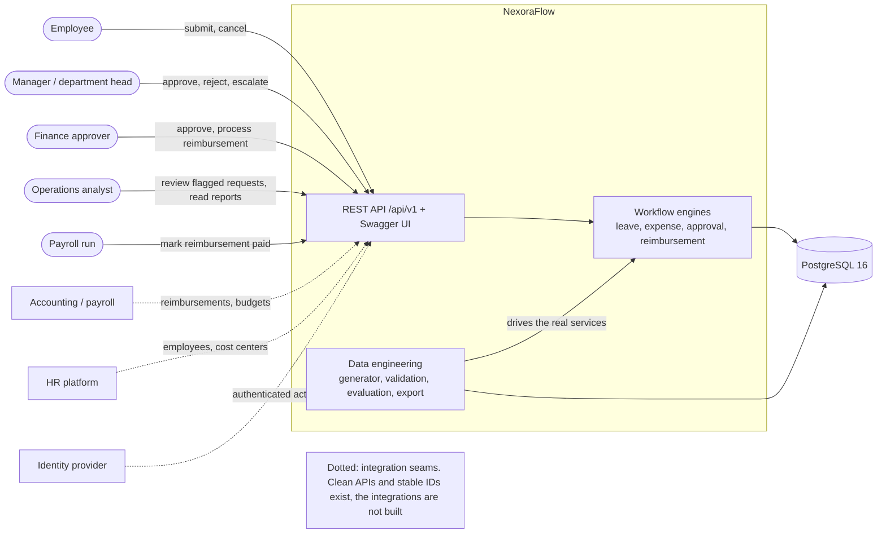

### 5.2 Modules and dependency rules

A **modular monolith**: one deployable, one database, feature packages. The approval engine knows nothing about leave or expenses - the two modules plug in through an `ApprovalOutcomeHandler` interface. The generator drives the *real* services, and nothing in the business engines reads the ground truth.

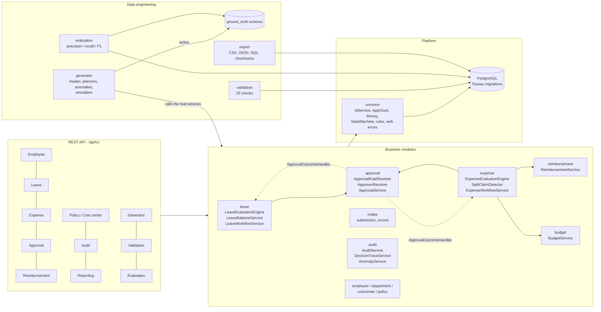

### 5.3 Layers inside a module

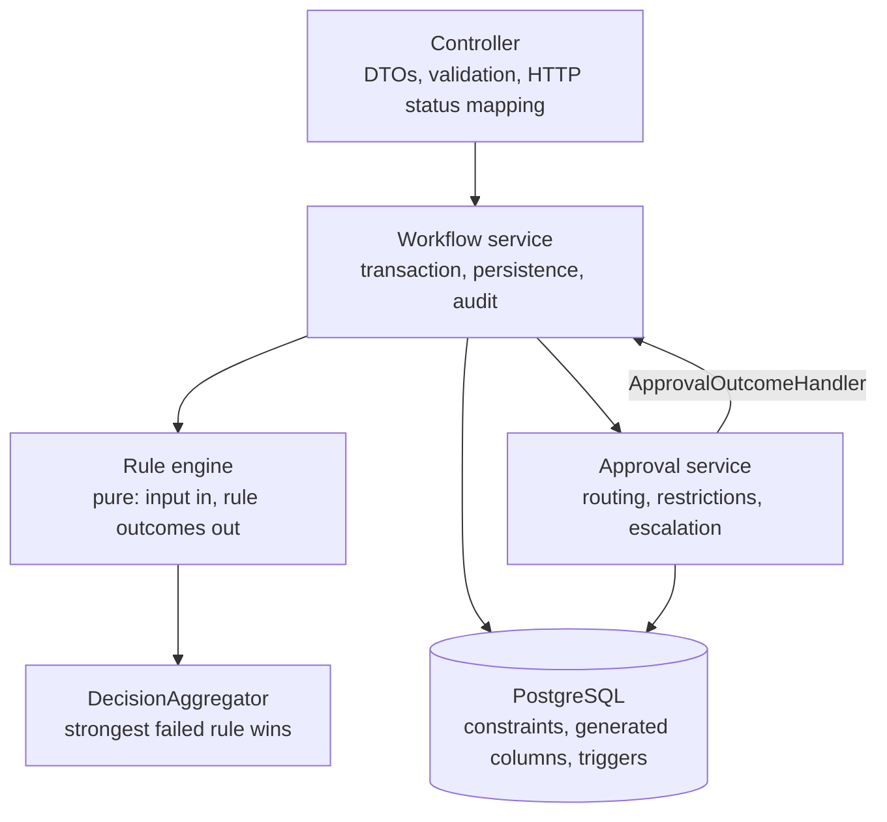

Rules are pure objects (`RuleOutcome`: id, verdict, severity, reason code, details); workflow services load data, call the engine, persist and audit. Business violations are returned as results, not thrown, so the audit event of a *prevented* action commits together with the unchanged state.

### 5.4 One request from end to end

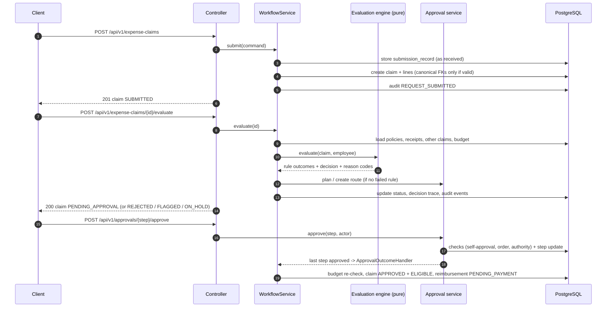

### 5.5 How a decision is made

Deterministic and explainable: the decision is the strongest failed rule (`HARD > HOLD > FLAG > REVIEW`), all failed rules are reported, and the decision trace keeps the full rule list.

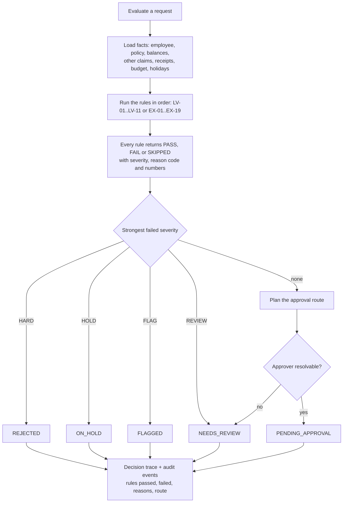

### 5.6 Lifecycles

Every state change is checked against an explicit state machine; a transition that is not drawn is rejected and recorded.

**Leave request**

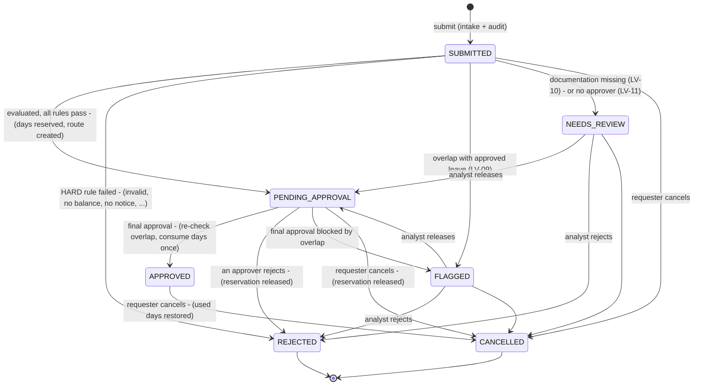

**Expense claim**

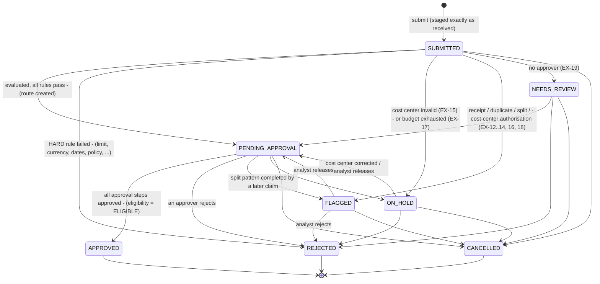

**Approval step** (terminal states are immutable - application and database trigger)

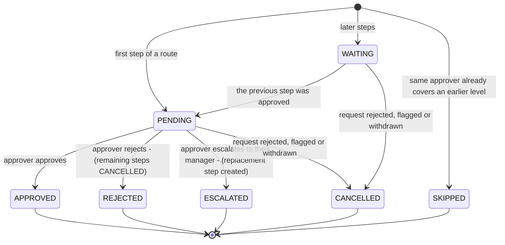

**Reimbursement**

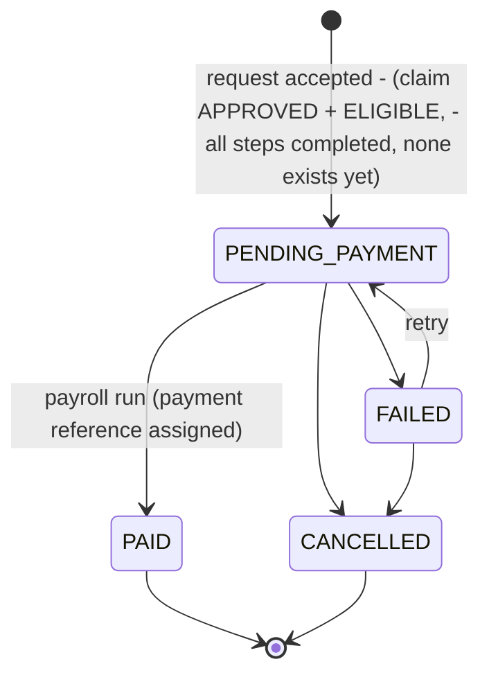

### 5.7 Approval routing

Thresholds are rows in `approval_rule`, not code. One rule is chosen per level (priority, then specificity, then ID); the approver is found in the reporting line or by designation, with escalation when someone is unavailable.

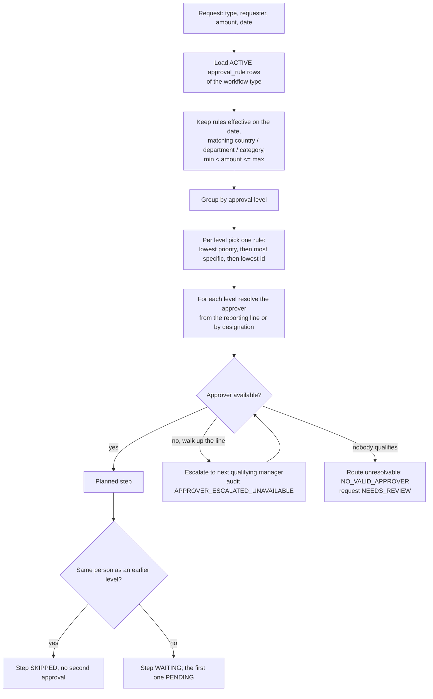

### 5.8 Leave: from submission to balance consumption

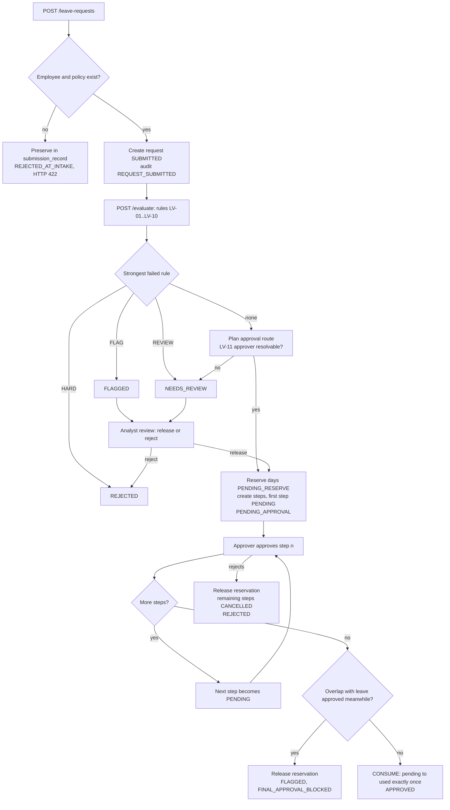

**Balance ledger** - `available = opening + accrued + carried forward - used - pending` is a generated column; every movement is an immutable ledger row.

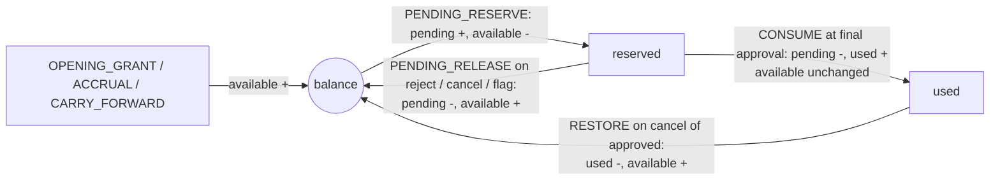

### 5.9 Expense: from submission to reimbursement

The reimbursement is created **automatically at final approval** (after a budget re-check); a later `POST /reimbursements` is an idempotent re-request that is refused and recorded. Duplicates are prevented four times over: row lock, existing-reimbursement check, unique constraint, database trigger.

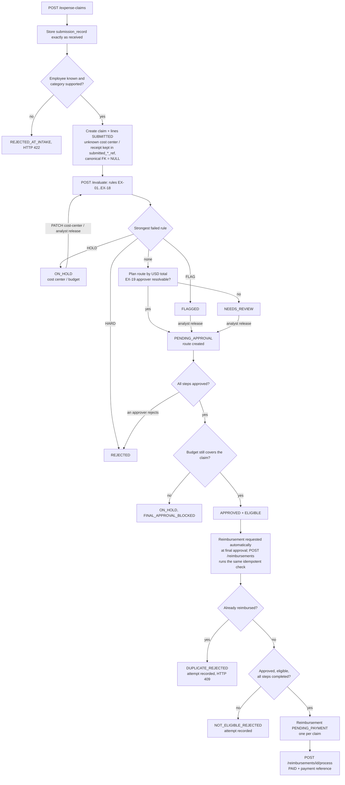

### 5.10 Data model

Core entities only; the full model (30 tables, constraints, indexes, triggers) is in [docs/database-schema.md](docs/database-schema.md) and every column in [docs/data-dictionary.md](docs/data-dictionary.md). Business identifiers are the primary keys.

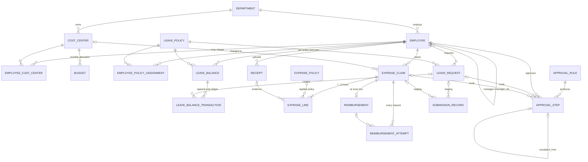

### 5.11 Data generation, validation and evaluation

The answer key is produced by independent logic and stored in its own schema; the data is produced by running the real services in simulated time; the evaluation compares the two afterwards.

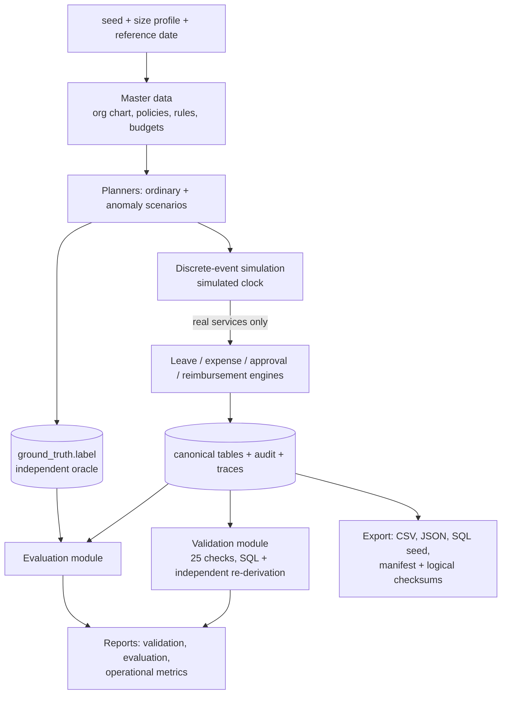

### 5.12 Deployment

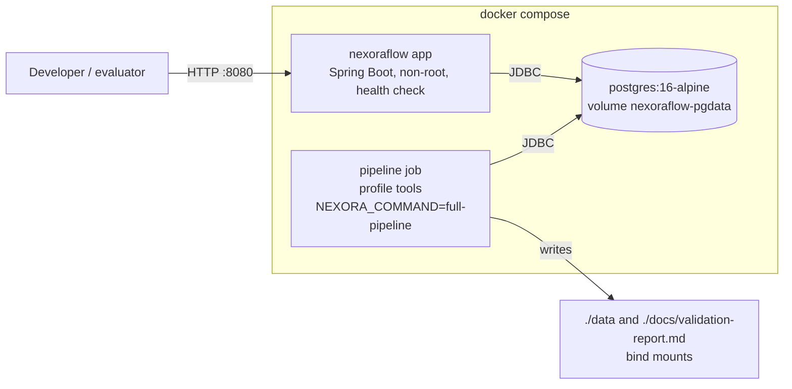

### 5.13 Design decisions

| Decision | Why |
|---|---|
| **Business identifiers are the primary keys** (`EMP-000001`, `EXP-2026-000001`, ...), assigned from atomic counters | every API payload, export row and audit record uses the same stable, readable ID; no gaps, no collisions |
| **Rules are data** (`approval_rule`, policies, budgets, holidays), not code | changing a threshold is a row update; routing, split-claim detection and the validator all follow it |
| **Decision = strongest failed rule**, every failure reported | deterministic, explainable, trivially testable; no hidden scoring, no randomness, no ML |
| **The database enforces the invariants too** (CHECK, exclusion, unique, generated columns, guard triggers) | a bug in the application cannot silently corrupt data; negative tests prove it |
| **Nothing derived is stored as truth** (available balance, budget position, claim total) | nothing can drift out of sync |
| **Reserve at evaluation, consume once at final approval** | concurrent requests cannot over-commit a balance; approval never deducts twice |
| **Invalid input is preserved** (`submission_record`, `submitted_*_ref`) while canonical foreign keys stay valid | nothing is lost for audit, nothing untrusted reaches canonical relations |
| **Simulated clock and per-stage random streams** | the dataset is a pure function of seed, configuration and versions: reproducible to the checksum |
| **Independent ground truth in its own schema** | the engines are graded by a second implementation, not by themselves |
| **Business violations are results, not exceptions** | the audit event of a prevented action must commit |
| **One database, one application, no broker or cache** | no infrastructure without a requirement |


## 6. Prerequisites

| For | You need |
|---|---|
| everything with Docker (easiest) | Docker with the Compose plugin (v2) |
| local development | JDK **21**, Docker (for PostgreSQL and for the integration tests), `curl` |

Maven is **not** required (the wrapper `./mvnw` is in the repository). Around 1.5 GB of free disk space is needed for Docker images and the Maven cache.

## 7. Local setup

```bash
git clone <repository-url> NexoraFlow
cd NexoraFlow
```

**Option A - everything in Docker (no JDK needed)**

```bash
docker compose up --build -d          # PostgreSQL + the API on http://localhost:8080
```

**Option B - application on the host, database in Docker**

```bash
scripts/dev-db.sh                     # PostgreSQL 16 on localhost:5432 (database/user nexoraflow)
./mvnw spring-boot:run                # the API on http://localhost:8080
```

Check that it works:

```bash
curl -s http://localhost:8080/actuator/health          # {"status":"UP", ...}
curl -s 'http://localhost:8080/api/v1/leave-policies'   # the seeded reference data is created by the generator, see section 11
```

A freshly migrated database is empty: run the generator (section 11) to load the company.

## 8. Database setup

The schema is created and versioned by **Flyway** at application start (`src/main/resources/db/migration`); nothing has to be run by hand. Hibernate only validates that the entities match the schema.

| | |
|---|---|
| Docker Compose | the `postgres` service (postgres:16-alpine, data in the named volume `nexoraflow-pgdata`, health check) |
| Stand-alone | `scripts/dev-db.sh [port]` starts a throw-away container; stop it with `docker rm -f nexoraflow-dev-db` |
| Your own server | create a database and a user and point `NEXORA_DB_URL`, `NEXORA_DB_USER`, `NEXORA_DB_PASSWORD` at it. The user needs to be able to create the `btree_gist` extension (it is bundled with PostgreSQL; on managed services enable it first) |

The default credentials (`nexoraflow` / `nexoraflow_dev`) are **development defaults**, there so that `docker compose up` works out of the box. Change them for anything shared.

## 9. Environment variables

| Variable | Default | Meaning |
|---|---|---|
| `NEXORA_DB_URL` | `jdbc:postgresql://localhost:5432/nexoraflow` | JDBC URL |
| `NEXORA_DB_USER` / `NEXORA_DB_PASSWORD` | `nexoraflow` / `nexoraflow_dev` | database credentials |
| `NEXORA_DB_POOL` | `10` | connection-pool size |
| `NEXORA_PORT` | `8080` | HTTP port |
| `NEXORA_DATA_DIR` | `data` | export directory |
| `NEXORA_DOCS_DIR` | `docs` | where `docs/validation-report.md` is written |
| `NEXORA_ALLOW_RESET` | `true` | whether the generator may reset the database (`false` forbids generation through the API) |
| `NEXORA_COMMAND` | empty | CLI mode: run a pipeline command and exit |

Compose variables (copy `.env.example` to `.env`): `POSTGRES_DB`, `POSTGRES_USER`, `POSTGRES_PASSWORD`, `NEXORA_DB_PORT` (host port of the database), `NEXORA_PORT`, `NEXORA_SIZE` (`SMALL`/`MEDIUM`/`LARGE`), `NEXORA_SEED`, `NEXORA_COMMAND`, `NEXORA_UID` / `NEXORA_GID` (Linux: run the containers as your user so files written to `./data` are yours).

Application properties (`application.yml`): `nexoraflow.generator.seed` (default `20261022`), `.size` (`MEDIUM`), `.reference-date` (`2026-10-22`), `nexoraflow.expense.max-lines-per-claim` (10), `.split-window-days` (3), `.supported-receipt-types`, `.max-receipt-size-bytes`.

## 10. Running the application

| How | Command |
|---|---|
| Docker Compose | `docker compose up --build -d` (stop: `docker compose down`, add `-v` to drop the database volume) |
| Maven | `./mvnw spring-boot:run` |
| Jar | `./mvnw -DskipTests package && java -jar target/NexoraFlow-1.0.0.jar` |

The API listens on <http://localhost:8080>. The database is empty until you run the generator (next section) or create employees yourself.

## 11. Generating synthetic data

Dataset parameters: **seed** (default `20261022`), **size profile**, **reference date** (the company's "today": `2026-10-22`).

| Profile | Employees | Leave requests | Expense claims | Anomaly volume |
|---|---:|---:|---:|---:|
| `SMALL` | 50 | 100 | 125 | 0.15x |
| `MEDIUM` (default, the brief's baseline) | 400 | 800 | 1,000 | 1x |
| `LARGE` | 2,000 | 4,000 | 5,000 | 5x |

The anomaly scenarios are **added on top** of the baseline volume (section 12).

**One command - the whole pipeline** (reset, generate, validate, evaluate, export, reports):

```bash
scripts/full-pipeline.sh                       # MEDIUM, default seed (needs the database from section 8)
scripts/full-pipeline.sh SMALL 42              # profile and seed
docker compose --profile tools run --rm pipeline          # same, fully in Docker
```

**Single commands** (each is a separate JVM run against the same database):

```bash
scripts/nexoraflow.sh generate-all [SIZE] [SEED]   # master + leave + expense + anomalies   (resets the database first)
scripts/nexoraflow.sh generate-master              # stage 1: organisation, policies, rules, budgets, balances (resets)
scripts/nexoraflow.sh generate-leave               # stage 2: baseline leave workload
scripts/nexoraflow.sh generate-expense             # stage 3: baseline expense workload
scripts/nexoraflow.sh generate-anomalies           # stage 4: designed anomaly scenarios
scripts/nexoraflow.sh validate | evaluate | export | reproducibility-check | reset
```

Through the API: `POST /api/v1/generator/run` with `{"command":"generate-all","size":"SMALL","seed":20261022}` and `GET /api/v1/generator/status`.

> **Warning:** the generating commands **truncate every business table** of the configured database. Never point them at a database you care about. Set `NEXORA_ALLOW_RESET=false` to forbid it through the API.

How the data is produced (per-stage seeded random streams, planners with their own restatement of the policy, a discrete-event simulation that drives the real services with a simulated clock) and what it contains: [docs/data-provenance.md](docs/data-provenance.md).

## 12. Generating anomaly scenarios

Anomaly scenarios are generated by the last stage (`generate-anomalies`, or as part of `generate-all` / `full-pipeline`) and are **added on top of** the baseline: the default dataset has 800 + 92 leave requests and 1,000 + 217 claims, plus 10 submissions rejected at intake. There are 39 designed scenario types (36 anomalous + 3 controls); the seven mandatory ones of the brief are:

| Mandatory scenario | `issue_type` | Entities |
|---|---|---:|
| Negative leave balance | `NEGATIVE_BALANCE` | 12 |
| Overlapping approved leave | `OVERLAPPING_APPROVED_LEAVE` | 7 |
| Expense outside employment dates | `OUTSIDE_EMPLOYMENT_PERIOD` | 12 |
| Split claims (+ negative control `SPLIT_CLAIM_CONTROL`) | `SUSPICIOUS_SPLIT_CLAIM` | 18 |
| Missing cost center | `MISSING_COST_CENTER` | 8 |
| Requester self-approval | `SELF_APPROVAL_ATTEMPT` | 10 |
| Duplicate reimbursement | `DUPLICATE_REIMBURSEMENT_ATTEMPT` | 8 |

All scenario types with their expected outcome, reason code and evidence are in [docs/data-provenance.md](docs/data-provenance.md#5-ground-truth-and-anomaly-scenarios). Every scenario writes its expected result into the **independent ground truth** (`ground_truth.label`, exported to `data/ground_truth/`); the business engines never read it. To generate *only* a clean baseline without anomalies, run `generate-master`, `generate-leave` and `generate-expense` and skip `generate-anomalies`.

## 13. Validating data

```bash
scripts/nexoraflow.sh validate        # 25 checks -> stored report; summary on stdout
scripts/nexoraflow.sh evaluate        # compare engine decisions with the ground truth
curl -X POST localhost:8080/api/v1/validation/run     # the same through the API
curl localhost:8080/api/v1/validation/report          # structured report (which check, which records)
curl -X POST localhost:8080/api/v1/evaluation/run
curl localhost:8080/api/v1/evaluation/report
```

The **validation** report lists 25 checks in three groups - database integrity (`DI-01..07`: keys, foreign keys, identifier formats, required fields, enums, date ranges), business integrity (`BI-01..10`: claim totals, balance reconciliation, consume-once, approval routes and authority, reimbursement eligibility and uniqueness, budget, lifecycle replay) and data quality (`DQ-01..08`: hierarchy, negative amounts, employment dates, currencies, duplicate receipts, overlapping leave, canonical references, preserved invalid submissions). A failing check names the records. The **evaluation** compares what the engines decided with the ground truth: anomaly detection (precision / recall / F1, false positives and negatives) and ordinary workflow decisions (outcome, approval path, reimbursement) are reported separately, with the list of mismatches; it also reports the safeguards that fired (invalid reimbursements prevented, unauthorised approvals prevented, failed lifecycle transitions) and the integrity counters (foreign-key validation failures, duplicate business identifiers). `scripts/full-pipeline.sh` also writes the human-readable [docs/validation-report.md](docs/validation-report.md).

## 14. Running the tests

```bash
scripts/run-tests.sh            # = ./mvnw verify  (unit + integration + acceptance)
./mvnw test -Dtest='*Test'      # any Maven test filter works
```

Integration and acceptance tests start PostgreSQL 16 through **Testcontainers**, so Docker must be running. If your Docker CLI points at a daemon you do not use (for example Docker Desktop is installed but stopped), select the right one first: `export DOCKER_HOST=unix:///var/run/docker.sock`.

Last executed full run: **166 tests, 0 failures, 0 errors, 1 skipped** (92 unit, 58 integration, 16 acceptance; `BUILD SUCCESS`, 01:56 min). The skipped test is the opt-in scale test described below.

| Level | What it covers |
|---|---|
| unit | pure rule engines (leave, expense, split-claim detector), business-day calculator, approval rule selection and restrictions, reimbursement rules, lifecycles, decision aggregation, money / IDs / clock / seeds |
| integration | real services on PostgreSQL: leave and expense workflows, database constraints and triggers, transactions and concurrency (parallel approvals, parallel reimbursements), the generator against the independent ground truth, validation / evaluation including deliberate corruption, export and reproducibility |
| acceptance | the ten scenarios of the brief through the REST API, the error contract, OpenAPI, the operational reports, a generate / validate / evaluate round trip |
| scale (opt-in) | `./mvnw test -Dtest=ScaleProfileIntegrationTest -Dnexora.scale=LARGE` generates a profile and requires zero mismatches against the ground truth and zero failed checks (several minutes, a few hundred MB of database space) |

The rule-to-test mapping is in [docs/business-rules.md](docs/business-rules.md#9-rule-catalogue-inputs-entity-outcome-and-test-scenario).

## 15. Exporting datasets

`full-pipeline` and `export` write the dataset to `data/` (default `NEXORA_DATA_DIR`):

```
data/generated/<entity>.csv|json      one pair per table (employees, departments, cost_centers, leave_policies, expense_policies,
                                      leave_balances, leave_requests, expense_claims, expense_lines, approval_rules, approval_steps,
                                      reimbursements, audit_events, ... 27 tables); relationships are business IDs
data/generated/sql/nexoraflow_seed.sql   the whole dataset as INSERTs for a Flyway-migrated database
data/ground_truth/ground_truth.csv|json  the independent answer key
data/manifests/generation_manifest.json  seed, size profile, configuration, versions, row counts, per-table logical checksums
data/manifests/checksums.json            SHA-256 of every exported file and the overall logical checksum
data/manifests/validation_summary.json
data/reports/                            validation_report.json, evaluation_report.json, evaluation_summary.md,
                                         decision_summary.md, operational_metrics.json
```

The committed `data/` is the default dataset (seed `20261022`, `MEDIUM`, 56M on disk). Load the SQL seed into a fresh database with `psql -f data/generated/sql/nexoraflow_seed.sql` after the application has migrated it once. Provenance, versioning and the reproducibility contract: [docs/data-provenance.md](docs/data-provenance.md).

## 16. Swagger documentation

With the application running:

- **Swagger UI:** <http://localhost:8080/swagger-ui.html>
- **OpenAPI JSON:** <http://localhost:8080/v3/api-docs>
- Written reference and conventions: [docs/api-documentation.md](docs/api-documentation.md)

## 17. Sample API requests and responses

The following were captured from a running instance on the default dataset (full set in [docs/api-documentation.md](docs/api-documentation.md#5-real-requests-and-responses)). IDs and times are those of that run.

**Submit and evaluate a leave request (5 business days)**

`evaluate=true` submits and evaluates in one call. The request is valid, so it enters the approval workflow and the 5 days are reserved.

```http
POST /api/v1/leave-requests?evaluate=true
Content-Type: application/json

{
  "employeeId": "EMP-000086",
  "leavePolicyId": "LPOL-ANNUAL-US",
  "startDate": "2026-12-07",
  "endDate": "2026-12-11",
  "reason": "Family holiday"
}
```

Response `201 Created`

```json
{
  "leaveRequestId": "LVE-2026-000893",
  "employeeId": "EMP-000086",
  "leavePolicyId": "LPOL-ANNUAL-US",
  "startDate": "2026-12-07",
  "endDate": "2026-12-11",
  "requestedDays": 5.0,
  "calculatedBusinessDays": 5.0,
  "reason": "Family holiday",
  "submissionDate": "2026-11-12",
  "requestStatus": "PENDING_APPROVAL",
  "decision": "PENDING_APPROVAL",
  "decisionReason": "",
  "createdAt": "2026-11-12T20:11:34.337741Z",
  "updatedAt": "2026-11-12T20:11:34.594160Z"
}
```

**The approver approves the step**

```http
POST /api/v1/approvals/APR-LVE-2026-000893-01/approve
Content-Type: application/json

{
  "actorEmployeeId": "EMP-000043",
  "comments": "Enjoy",
  "reason": "approved"
}
```

Response `200 OK`

```json
{
  "approvalStepId": "APR-LVE-2026-000893-01",
  "requestType": "LEAVE",
  "requestId": "LVE-2026-000893",
  "stepSequence": 1,
  "approvalLevel": 1,
  "approverRole": "DIRECT_MANAGER",
  "approverEmployeeId": "EMP-000043",
  "approvalStatus": "APPROVED",
  "approvalRuleId": "AR-LV-001",
  "assignedAt": "2026-11-12T20:11:34.558855Z",
  "actionAt": "2026-11-12T20:11:34.727396Z",
  "comments": "Enjoy",
  "decisionReason": "approved"
}
```

**Submit and evaluate an expense claim with two lines**

2,500.00 USD falls into the 2,000-5,000 USD tier, which requires two approval levels (manager, then Finance Manager).

```http
POST /api/v1/expense-claims?evaluate=true
Content-Type: application/json

{
  "employeeId": "EMP-000086",
  "expensePeriodStart": "2026-11-09",
  "expensePeriodEnd": "2026-11-10",
  "costCenterId": "CC-0002",
  "currency": "USD",
  "lines": [
    {
      "category": "TRAVEL",
      "merchantName": "Skyway Air",
      "transactionDate": "2026-11-09",
      "description": "Flight to customer site",
      "amount": "1300.00",
      "receipt": {
        "fileName": "skyway-air-outbound.pdf",
        "fileType": "PDF",
        "fileSizeBytes": 183240,
        "receiptHash": "63e936135d5f992aa8486a3a5ecf5c134b1350513ca57e8051e0ae8b8fa9d8d1"
      }
    },
    {
      "category": "TRAVEL",
      "merchantName": "Skyway Air",
      "transactionDate": "2026-11-10",
      "description": "Return flight",
      "amount": "1200.00",
      "receipt": {
        "fileName": "skyway-air-return.pdf",
        "fileType": "PDF",
        "fileSizeBytes": 176912,
        "receiptHash": "a22aee2db07b90c326c131eb81f9b816a53cb0d797b7596107206195c53f1d9f"
      }
    }
  ]
}
```

Response `201 Created`

```json
{
  "expenseClaimId": "EXP-2026-001218",
  "employeeId": "EMP-000086",
  "claimDate": "2026-11-12",
  "expensePeriodStart": "2026-11-09",
  "expensePeriodEnd": "2026-11-10",
  "submissionDate": "2026-11-12",
  "costCenterId": "CC-0002",
  "submittedCostCenterRef": "CC-0002",
  "currency": "USD",
  "totalAmount": 2500.0,
  "claimStatus": "PENDING_APPROVAL",
  "eligibilityStatus": "ELIGIBLE",
  "decision": "PENDING_APPROVAL",
  "decisionReason": "",
  "createdAt": "2026-11-12T20:11:35.160424Z",
  "updatedAt": "2026-11-12T20:11:35.346212Z",
  "lines": [
    {
      "expenseLineId": "EXPL-EXP-2026-001218-01",
      "lineNumber": 1,
      "expensePolicyId": "XPOL-TRAVEL-US",
      "expenseCategory": "TRAVEL",
      "merchantName": "Skyway Air",
      "transactionDate": "2026-11-09",
      "description": "Flight to customer site",
      "amount": 1300.0,
      "currency": "USD",
      "amountReporting": 1300.0,
      "receiptId": "RCP-002350",
      "costCenterId": "CC-0002",
      "lineStatus": "VALID"
    },
    {
      "expenseLineId": "EXPL-EXP-2026-001218-02",
      "lineNumber": 2,
      "expensePolicyId": "XPOL-TRAVEL-US",
      "expenseCategory": "TRAVEL",
      "merchantName": "Skyway Air",
      "transactionDate": "2026-11-10",
      "description": "Return flight",
      "amount": 1200.0,
      "currency": "USD",
      "amountReporting": 1200.0,
      "receiptId": "RCP-002351",
      "costCenterId": "CC-0002",
      "lineStatus": "VALID"
    }
  ]
}
```

**Requesting it again is refused and recorded**

Idempotent by design: exactly one reimbursement exists per claim; the duplicate attempt is stored in `reimbursement_attempt` and audited (`REIMBURSEMENT_DUPLICATE_REJECTED`).

```http
POST /api/v1/reimbursements
Content-Type: application/json

{
  "expenseClaimId": "EXP-2026-001218",
  "requestedBy": "EMP-000024"
}
```

Response `409 Conflict`

```json
{
  "detail": "Claim EXP-2026-001218 already has reimbursement RMB-2026-000878",
  "instance": "/api/v1/reimbursements",
  "status": 409,
  "title": "Conflict",
  "type": "https://nexoraflow.example/problems/conflict",
  "timestamp": "2026-11-12T20:11:35.613598975Z",
  "reasonCode": "DUPLICATE_REIMBURSEMENT"
}
```

**A requester tries to approve their own request**

Refused with `403`; the attempt is recorded in the audit trail (`APPROVAL_ATTEMPT_REJECTED`, category `VIOLATION`) and the request is unchanged.

```http
POST /api/v1/approvals/APR-LVE-2026-000895-01/approve
Content-Type: application/json

{
  "actorEmployeeId": "EMP-000086",
  "comments": "approving myself"
}
```

Response `403 Forbidden`

```json
{
  "detail": "Requester EMP-000086 cannot approve their own request",
  "instance": "/api/v1/approvals/APR-LVE-2026-000895-01/approve",
  "status": 403,
  "title": "Forbidden",
  "type": "https://nexoraflow.example/problems/forbidden",
  "timestamp": "2026-11-12T20:11:34.958481802Z",
  "reasonCode": "SELF_APPROVAL_NOT_ALLOWED"
}
```


## 18. Limitations and assumptions

The complete list is in [docs/assumptions.md](docs/assumptions.md). The ones to know first:

- **No authentication.** The five business actors are represented by `actorEmployeeId` fields; *business* authorisation (who may approve what) is enforced, a login is not. Do not expose the application to an untrusted network as is.
- **Everything is synthetic.** No real person or company. Fixed illustrative FX rates (EUR 1.09, GBP 1.27, INR 0.012, SGD 0.74 to USD), illustrative holiday calendars, receipts are metadata only.
- **The brief's baseline is the ordinary workload;** anomaly scenarios are added on top (so the default dataset has more than 800 / 1,000 records).
- **The perfect evaluation score is a consistency result:** the ground truth is an independently *written* answer key for scenarios the same author designed. It shows the engines follow the documented rules; it does not show the rules are right for a real company, and the anomaly rate (about 11.7 %) is far higher than in real life.
- **Split-claim detection is a heuristic** (same employee, cost center, category and merchant, chained within 3 days); different merchant spellings are not linked and legitimate repeat purchases can be flagged for review.
- **Leave:** one calendar year per request, no automatic year-end rollover job, no half days, no part-time pro-rating; overlap is checked against approved leave only (a second approval is blocked at the final step).
- **Generation resets the database** and only one run can be active at a time.
- **The public GitHub repository** required by the brief's Definition of Done is a manual step; none was created.

## Results: what was measured

All numbers below come from runs executed during development (Docker image built from this source; full test suite; pipeline runs). They describe the *synthetic* dataset and the rule engines, not a real company.

### Tests

| | |
|---|---|
| Command | `./mvnw verify` (Docker running) |
| Result | **166 tests, 0 failures, 0 errors, 1 skipped** - `BUILD SUCCESS` (01:56 min) |
| Split | 92 unit, 58 integration, 16 acceptance |

### Default dataset (seed `20261022`, `MEDIUM`, reference date `2026-10-22`)

| | |
|---|---|
| Rows | 400 employees, 892 leave requests, 1217 expense claims (2599 lines), 2169 approval steps, 877 reimbursements, 17226 audit events, 2119 ground-truth labels |
| Baseline volume | 800 leave requests and 1000 claims (exactly as specified); scenarios add 92 leave requests, 217 claims and 10 intake-rejected submissions |
| Validation | **25 checks: 24 passed, 0 failed, 1 informational** (0 findings; the informational check DQ-08 reports the deliberately invalid submissions that were preserved) |
| Anomaly detection | 247 anomalies labelled, 247 detected, 0 undetected, 0 false positives - precision 1.0, recall 1.0, F1 1.0 |
| Ordinary workflow decisions | 2119 evaluated, 2119 correct - outcome accuracy 100.00 %; approval paths 1922 / 1922 correct |
| Reimbursement decisions | 1217 claims evaluated, 1217 correct; claims with more than one reimbursement: 0 |
| Mismatches vs. ground truth | 0 |
| Integrity counters (evaluation report) | foreign-key validation failures: 0; duplicate business identifiers: 0; invalid reimbursements prevented: 16 (duplicates 12); unauthorised approvals prevented: 14; failed lifecycle transitions recorded: 8 |
| Generation time | 66 s for the full pipeline (generate, validate, evaluate, export, reports) in the Docker container on the development machine |
| Reproducibility | `reproducibility-check`: **2 runs, identical = true**, differences: 0; overall logical checksum `d88f798469546a74306ed0d04ea3d3d71a9290b037318ab8de3e46e23e8991b5`; also identical between a JVM in `Asia/Kolkata` and one in `UTC`, and between a host run and a Docker run |

### Large profile (`LARGE`: 2,000 employees, 4,000 leave requests, 5,000 claims, 5x anomaly volume)

| | |
|---|---|
| Generation | 562 s |
| Validation | 25 checks: 24 passed, 0 failed, 1 informational |
| Anomaly detection | 1171 labelled, 1171 detected, 0 false positives - precision 1.0, recall 1.0, F1 1.0 |
| Ordinary workflow decisions | 10481 evaluated, outcome accuracy 100.00 %; approval path accuracy 100.00 % |
| Reimbursement decisions | 6058 evaluated, accuracy 100.00 % |
| Mismatches vs. ground truth | 0 |

The LARGE profile was generated, validated and evaluated with the final code on the host JVM against a PostgreSQL 16 container. Its **first** run, before the fixes described in [docs/design-analysis.md](docs/design-analysis.md#7-defects-found-by-the-validation-and-evaluation-modules), was *not* clean (one failed validation check, four mismatches against the ground truth); the table shows the result after the fixes. The check is repeatable with the opt-in test `./mvnw test -Dtest=ScaleProfileIntegrationTest -Dnexora.scale=LARGE` (several minutes, a few hundred MB of database space).

### Docker

The final image was built from this source with `docker compose build`. Started with `docker compose up` it became `healthy`, served Swagger UI and the OpenAPI document, and ran a SMALL generation, validation and evaluation through the REST API (24 checks passed, 0 failed, 1 informational; no mismatch against the ground truth). The one-shot `pipeline` job ran the complete MEDIUM pipeline and then the reproducibility check inside the container; these runs produced the committed `data/` directory and `docs/validation-report.md`. The requests of section 17 were captured from the application container of an earlier build of the same sources (the API code has not changed since; only the generator was refined afterwards).

## Repository layout

```
src/main/java/me/niteshh/nexoraflow/     feature packages: common, configuration, employee, department, costcenter, policy, budget,
                                         leave, expense, approval, reimbursement, intake, audit, reporting,
                                         generator (master, plan, anomaly, sim, truth), validation, evaluation, export
src/main/resources/db/migration/         Flyway V1..V6
src/test/java/me/niteshh/nexoraflow/     unit/, integration/, acceptance/, support/
data/                                    generated dataset, ground truth, manifests, reports
docs/                                    architecture, database, business rules, API, provenance, assumptions, reports
scripts/                                 nexoraflow.sh, full-pipeline.sh, full-pipeline-docker.sh, dev-db.sh, run-tests.sh
README.md · PROMPTS.md · Dockerfile · docker-compose.yml · .env.example · pom.xml · mvnw
```

## Documentation index

| Document | Content |
|---|---|
| [docs/architecture.md](docs/architecture.md) | modules, dependency rules, request flow, design decisions, deployment, configuration |
| [docs/database-schema.md](docs/database-schema.md) | ER diagram, design principles, constraints, indexes, triggers (generated from the live schema) |
| [docs/data-dictionary.md](docs/data-dictionary.md) | every table and column |
| [docs/business-rules.md](docs/business-rules.md) | every rule with inputs, conditions, outcome, reason code, entity and test; reason-code catalogue |
| [docs/workflow-diagrams.md](docs/workflow-diagrams.md) | state diagrams and flows (Mermaid) |
| [docs/api-documentation.md](docs/api-documentation.md) | conventions, endpoint reference, real requests and responses |
| [docs/data-provenance.md](docs/data-provenance.md) | origin, generation method, reproducibility contract, scenario catalogue |
| [docs/assumptions.md](docs/assumptions.md) | interpretations, assumptions, limitations |
| [docs/validation-report.md](docs/validation-report.md) | generated validation and evaluation report of the committed dataset |
| [docs/design-analysis.md](docs/design-analysis.md) | requirement traceability, risks, defects found and fixed, FDE perspective, Definition of Done |
| [PROMPTS.md](PROMPTS.md) | how AI was used: which tool did what, where it sped things up, where it was relied on, what was personally reviewed and checked |
| [docs/prompt-log.md](docs/prompt-log.md) | the prompts typed to Claude Code, word for word, with a note in plain words on each; six review prompts written afterwards (not history); a place for the GPT prompts |

## Troubleshooting

| Symptom | Fix |
|---|---|
| `Could not find a valid Docker environment` in tests | start Docker; if the CLI uses a stopped Docker Desktop context: `export DOCKER_HOST=unix:///var/run/docker.sock` |
| `Connection refused` on 5432 | the database is not running (`scripts/dev-db.sh` or `docker compose up -d postgres`); port taken: `scripts/dev-db.sh 5433` and `export NEXORA_DB_URL=jdbc:postgresql://localhost:5433/nexoraflow` |
| `permission denied` writing `./data` from the Compose pipeline (Linux) | set `NEXORA_UID=$(id -u)` and `NEXORA_GID=$(id -g)` in `.env` |
| `Generation is disabled` (403) | `NEXORA_ALLOW_RESET=true` |
| `A generation run is already in progress` (409) | wait for `GET /api/v1/generator/status` to report `COMPLETED` |
| Java version errors | JDK 21 is required (`java -version`) |
