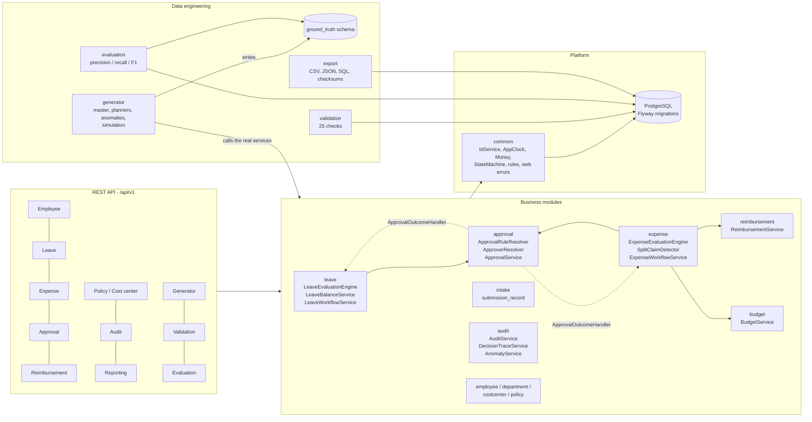
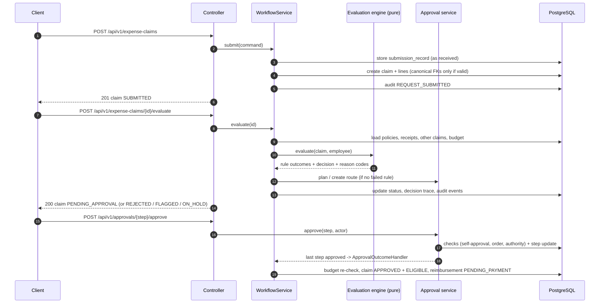
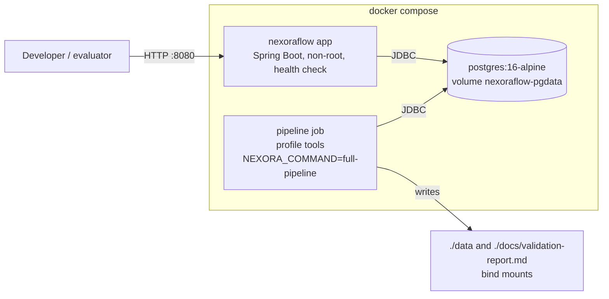

# Architecture

NexoraFlow is a **modular monolith**: one deployable Spring Boot application, one PostgreSQL database, with strict feature-oriented module boundaries inside the code. It automates the leave-request, expense-claim, approval and reimbursement workflows of a fictional company (Nexora Technologies) and ships with a deterministic synthetic-data engine, an independent ground truth, and validation / evaluation modules that prove the workflows behave as specified.

## 1. Technology

| Concern | Choice |
|---|---|
| Language / runtime | Java 21 |
| Framework | Spring Boot 4.0.9 (Spring Framework 7, Hibernate 7, Jackson 3) with Spring Web MVC, Data JPA, Validation, Actuator |
| Database | PostgreSQL 16 (exclusion constraints via `btree_gist`, generated columns, triggers, JSONB) |
| Migrations | Flyway 11 (`V1..V6`); Hibernate `ddl-auto=validate` - the schema is owned by migrations, never by the ORM |
| API docs | springdoc-openapi (OpenAPI 3, Swagger UI) |
| Synthetic data | Datafaker (successor of JavaFaker) driven by seeded `java.util.Random` |
| Build | Maven (wrapper included), Spring Boot Maven plugin (`build-info`) |
| Tests | JUnit 5, Mockito, Spring Boot Test + MockMvc, Testcontainers (PostgreSQL 16) |
| Packaging | multi-stage Docker image (non-root, health check), Docker Compose |
| Lombok | used only on JPA entities for boilerplate; business logic is plain Java |

## 2. Module map

Dependency rules that keep the modules independent:

- **The approval engine knows nothing about leave or expenses.** When the last approval step is approved or a step is rejected, `ApprovalService` calls an `ApprovalOutcomeHandler` interface; `LeaveApprovalHandler` and `ExpenseApprovalHandler` implement it (dependency inversion). Leave consumes balance, expense becomes `APPROVED` - the approval module never sees either.
- **Rules are pure.** `LeaveEvaluationEngine`, `DecisionAggregator`, `SplitClaimDetector`, `ApprovalRuleResolver.select`, `BusinessDayCalculator` take values in and return values out; they are unit-tested without a database. The `*WorkflowService` classes load the data, call the engine, persist and audit.
- **The generator drives the real services.** It does not insert rows. Submissions, approvals, cancellations and payroll runs are executed in simulated time against the same services the REST API uses, so generated balances, approval histories and audit trails are genuine consequences of the business rules.
- **The engines never read `ground_truth`.** It lives in its own schema, is written only by the generator and read only by `evaluation`.

## 3. Package layout

`me.niteshh.nexoraflow.*`

| Package | Responsibility |
|---|---|
| `common` | `IdService` (business IDs), `AppClock` (single source of "now"), `Money` (scale 2, HALF_UP), `StateMachine`, `ReasonCode`, `WorkflowResult`, `rules/*` (`RuleOutcome`, `RuleSeverity`, `DecisionAggregator`), `web/*` (RFC 7807 error handling, pagination), `DatabaseResetService` |
| `configuration` | typed `nexoraflow.*` properties, OpenAPI metadata, JSON support, currency / country entities |
| `employee`, `department`, `costcenter`, `policy`, `budget` | master data, policies, assignments, budget position (always derived from source claims) |
| `leave` | requests, balances and the immutable ledger, accrual, provisioning, business-day calculation, evaluation engine, workflow, approval handler |
| `expense` | claims, lines, receipts, evaluation engine, split-claim detector, workflow, approval handler |
| `approval` | configurable rules, routing, approver resolution, step execution and restrictions |
| `reimbursement` | idempotent reimbursement, attempts log, payment |
| `intake` | `submission_record` staging of every submission as received |
| `audit` | append-only audit events, per-evaluation decision traces, detected anomalies, explanation data |
| `generator` | seeds, size profiles, master data, planners (ordinary + anomaly scenarios), discrete-event simulation, ground-truth store, pipeline commands, CLI runner, reproducibility check |
| `validation` | 25 integrity / business / data-quality checks and the structured report |
| `evaluation` | comparison of engine results with the ground truth, metrics and mismatches |
| `export` | table catalogue, CSV / JSON / SQL export, logical checksums, report writer |
| `reporting` | operational metrics and decision explanations |

## 4. Request flow

Business violations (self-approval, wrong order, duplicate reimbursement, invalid transition, ...) are returned as `WorkflowResult.rejected(reasonCode, message)` rather than thrown, so the audit event describing the *prevented* action is committed together with the unchanged state. Controllers translate a rejected result into the HTTP status (`403`, `409`, `422`).

## 5. Key design decisions

| Decision | Why |
|---|---|
| **Business identifiers are primary keys** (`EMP-000001`, `LVE-2026-000001`, ...), assigned by `IdService` from the atomic `id_counter` table (`INSERT .. ON CONFLICT DO UPDATE .. RETURNING`). Entities implement `Persistable<String>`. | Every API payload, export row and audit record uses the same stable, readable ID. Counters live in the same transaction as the entity, so there are no gaps and concurrent callers never collide. |
| **Rules are data, not code** for everything a business user would change: approval thresholds (`approval_rule`), leave and expense policy limits, budgets, holidays. | Changing a threshold is a data change, tested by the same engine. Split-claim detection reads its boundaries from the active approval rules, so it cannot disagree with routing. |
| **Decision = strongest failed rule** (`HARD > HOLD > FLAG > REVIEW`), all failures reported. | Deterministic, explainable, easy to test; no hidden scoring. |
| **Defence in depth in the database**: CHECK, exclusion and unique constraints, generated columns, guard triggers (self-approval, completed steps, reimbursement eligibility, append-only history). | An application bug cannot silently corrupt data. The negative tests prove the database rejects violations on its own. |
| **Derived, not stored**: available leave balance (generated column), budget position (from claims), claim total (checked, BI-01). | Nothing to drift out of sync. |
| **Reserve at evaluation, consume at final approval** for leave balance. | Concurrent requests cannot over-commit; approval never deducts twice. |
| **Invalid input is preserved** in `submission_record` and `submitted_*_ref` columns; canonical FKs stay valid. | Nothing is lost for audit, nothing untrusted reaches canonical relations. |
| **Single clock** (`AppClock`); the simulation pins it per event. No SQL `DEFAULT now()`. | Generated timestamps are a function of the seed -> reproducible datasets. |
| **Per-stage random streams**: `SHA-256(seed:stage)` seeds a `java.util.Random` (algorithm fixed by the JDK spec). | A stage's output does not depend on how many random numbers another stage consumed; identical across JVMs and platforms. |
| **Independent ground truth**: planners compute the expected outcome with their own restatement of the policy (`BusinessPolicyBaseline`, `ApprovalOracle`) and shadow ledgers, in a separate schema. | The evaluation compares two independent implementations; the engine cannot be graded against itself. |
| **Optimistic locking** (`version`) on mutable aggregates, **row locks** (`SELECT .. FOR UPDATE`) where a check-then-act race matters (reimbursement per claim). | Lost updates fail loudly; double reimbursement is impossible under concurrency (tested). |

## 6. Concurrency and transactions

- Each service operation is one transaction; rejected business outcomes commit their audit events, unexpected exceptions roll everything back.
- `ReimbursementService` locks the claim row, so concurrent requests are serialised; a unique constraint on `expense_claim_id` is the last line of defence.
- Leave balance changes are ledger postings; unique partial indexes make accrual idempotent per balance and month and make CONSUME / RESTORE happen at most once per request.
- Final leave approval re-checks overlaps at the moment of approval to close the race between two requests approved in parallel.
- The generator is single-threaded and strictly ordered (ties broken by creation order), which is what makes the dataset deterministic.

## 7. Runtime and deployment

| Service | Purpose |
|---|---|
| `postgres` | PostgreSQL 16 with a health check; data in a named volume |
| `app` | the REST API on port 8080 (`/swagger-ui.html`, `/v3/api-docs`, `/actuator/health`) |
| `pipeline` (profile `tools`) | one-shot job: reset -> generate -> validate -> evaluate -> export -> reports; set `NEXORA_COMMAND` to run a single stage |

The same commands run without Docker through `scripts/nexoraflow.sh` (Maven `spring-boot:run` with `--nexoraflow.cli.command=<command>`).

### Configuration (environment variables)

| Variable | Default | Meaning |
|---|---|---|
| `NEXORA_DB_URL` | `jdbc:postgresql://localhost:5432/nexoraflow` | JDBC URL |
| `NEXORA_DB_USER` / `NEXORA_DB_PASSWORD` | `nexoraflow` / `nexoraflow_dev` | local-development defaults; **change for any shared environment** |
| `NEXORA_PORT` | `8080` | HTTP port |
| `NEXORA_DATA_DIR` / `NEXORA_DOCS_DIR` | `data` / `docs` | export and report output directories |
| `NEXORA_ALLOW_RESET` | `true` | whether the generator may reset the database |
| `NEXORA_COMMAND` | empty | CLI mode: run a pipeline command and exit |
| `nexoraflow.generator.seed` / `.size` / `.reference-date` | `20261022` / `MEDIUM` / `2026-10-22` | generation parameters (also settable per API call) |
| `nexoraflow.expense.*` | 10 lines, 3-day split window, `PDF,JPG,JPEG,PNG,HEIC`, 10 MiB | tunable expense-engine parameters |

No secret is committed: the only credentials in the repository are the development defaults above (so that `docker compose up` works out of the box) and the throw-away `test` / `test` credentials of the Testcontainers database used by the tests.

## 8. Quality attributes

| Attribute | How it is achieved / verified |
|---|---|
| **Correctness** | pure rule engines with unit tests; 25 validation checks; independent ground-truth comparison (100 % decision accuracy and 247 / 247 anomalies on the baseline dataset) |
| **Determinism / reproducibility** | seeded streams, simulated clock, sorted inputs, no wall-clock defaults; proven by tests (two generations identical, staged = generate-all, SQL seed reload = same checksums) and by an identical logical checksum between a JVM in `Asia/Kolkata` and one in `UTC`, and between a host run and a Docker run |
| **Integrity** | DB constraints / triggers; negative tests that corrupt data and assert the validator or the database catches it |
| **Auditability** | append-only audit events and decision traces for every state change and every prevented violation |
| **Explainability** | per-evaluation rule trace; `/explanation` endpoints; stable reason codes |
| **Testability** | engines are pure; integration tests run against real PostgreSQL via Testcontainers |
| **Operability** | health endpoint, stage-level logging, one-command pipeline, run metadata in `data/manifests/generation_manifest.json` (and in `generation_run` for runs started through the API) |

## 9. Extending the system

| Change | Where |
|---|---|
| New approval threshold or level | insert new effective-dated rows in `approval_rule` and end-date the old ones (no code change, no restart); do not `UPDATE` a boundary in place, it changes how every historical claim is judged; add a test row in `ApprovalRuleResolverTest` if it introduces a new scope |
| New expense category or policy | add the enum value (+ migration `CHECK`), seed an `expense_policy` row; every rule works unchanged |
| New leave type | add the enum value (+ migration), seed a `leave_policy` and assignments |
| New business rule | add a rule method to the engine returning a `RuleOutcome` (ID, severity, reason code), add the reason code, document it in [business-rules.md](business-rules.md), add a unit test; if it is an anomaly scenario, add it to the scenario planner so the ground truth covers it |
| New check in the validator | add a method to `ValidationService` producing a `Check` with its violating records |
| Different weekend / holiday calendar | `BusinessDayCalculator` already takes the weekend set; add holiday calendar rows |

## 10. Known architectural limitations

See [assumptions.md](assumptions.md) for the complete list. The ones that shape the architecture:

- **No authentication or authorisation layer.** The five business actors (employee, manager, finance approver, operations analyst, system / payroll) are represented by IDs in request payloads (`actorEmployeeId`); the *business* authorisation (who may approve what) is enforced, but a real deployment needs Spring Security / an identity provider in front.
- **Single instance.** The application is stateless apart from the database and could run several instances (ID allocation and locks are database-based), but this has not been load-tested.
- **Synchronous workflow.** Evaluation, routing and approval are synchronous service calls; there are no queues or notifications.
- **Fixed illustrative FX rates** instead of a rate feed.
