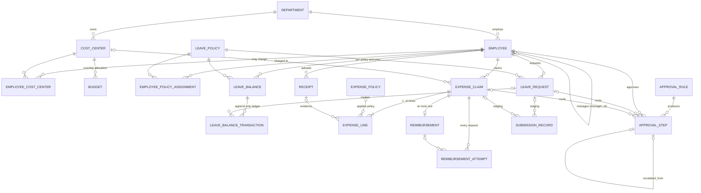

# Database schema

PostgreSQL 16, created and versioned exclusively by Flyway migrations (`src/main/resources/db/migration/V1..V6`). Hibernate runs with `ddl-auto=validate`: it never creates or alters tables, it only checks that the entities match the migrated schema.

| Migration | Content |
|---|---|
| `V1__reference_and_master_data.sql` | id counters, currency, country, department, employee (+ hierarchy trigger), cost center, employee-cost-center, holiday calendar, holiday |
| `V2__policies_rules_budgets.sql` | leave policy, expense policy, approval rule, budget, employee-policy assignment |
| `V3__leave.sql` | leave balance (generated `available_balance`), leave request, append-only leave-balance ledger |
| `V4__expense.sql` | receipt, expense claim, expense line, submission staging record, detected anomaly |
| `V5__approval_reimbursement_audit.sql` | approval step (+ guard trigger), reimbursement (+ guard trigger), reimbursement attempt, audit event, decision trace (both append-only) |
| `V6__ground_truth_and_runs.sql` | `ground_truth.label` (separate schema), generation run, report snapshot |

The complete column-level description is in [data-dictionary.md](data-dictionary.md); the generated constraint / index / trigger reference is at the end of this page.

## Entity-relationship diagram

Core business entities. Reference tables (`currency`, `country`, `holiday*`, `id_counter`) and operational tables (`generation_run`, `report_snapshot`) are left out to keep the diagram readable.

Not drawn because they are polymorphic (`entity_type` + `entity_id`, deliberately without foreign keys so that the trail can describe entities that were rejected before they existed): `audit_event`, `decision_trace`, `detected_anomaly` and `ground_truth.label`.

## Design principles

1. **Business identifiers are the primary keys.** `EMP-000001`, `LVE-2026-000001`, `EXP-2026-000001`, `EXPL-EXP-2026-000001-01`, `APR-LVE-2026-000001-01`, `RMB-2026-000001` ... are assigned by `IdService` from the atomic `id_counter` table. A rolled-back transaction rolls back its ID allocation too, so there are no gaps.
2. **Nothing derived is stored as truth.** `leave_balance.available_balance` is a *generated column*; budget consumption is derived from source claims by `BudgetService`; the claim total is checked against its lines (BI-01).
3. **The database is the last line of defence.** Every rule the business engines enforce that is cheap to express in SQL is also enforced by the schema (see the table below). A bug in the application therefore cannot silently corrupt the data - it fails loudly.
4. **History is append-only.** `audit_event`, `decision_trace` and `leave_balance_transaction` reject `UPDATE` and `DELETE`; approval steps can neither be deleted nor changed once completed.
5. **Invalid input is preserved, not discarded and not trusted.** Invalid employee, cost-center or receipt references never reach canonical foreign keys; the submission is kept in `submission_record` and the original value in `submitted_*_ref` columns.
6. **Determinism.** No column has a wall-clock default; every timestamp comes from the application clock, which is a simulated clock during generation.
7. **Ground truth is physically separate.** It lives in schema `ground_truth`; no business repository maps it.

## What the database enforces

| Guarantee | Mechanism |
|---|---|
| Employee cannot be their own manager; no reporting cycles | `trg_employee_hierarchy` (+ `ck_employee_not_own_manager`) |
| Termination date present if and only if status is `TERMINATED`; termination not before joining | `ck_employee_termination_consistency`, `ck_employee_dates` |
| Unique e-mail (case-insensitive) | `ux_employee_email_lower` |
| No overlapping PRIMARY cost-center assignments, leave-policy assignments, budgets, active expense policies, active leave policies | exclusion constraints (`btree_gist`) |
| Leave balance components never negative; `available_balance` always consistent | `CHECK`s + generated column |
| Balance ledger is immutable; accrual is idempotent per balance and period; a request can be consumed / restored at most once | `trg_leave_balance_txn_immutable`, `ux_lbt_accrual_period`, `ux_lbt_request_once` |
| An approval step targets exactly one of leave request / expense claim | `ck_step_single_target` |
| No self-approval; completed steps are immutable; steps cannot be deleted or re-assigned | `trg_approval_step_guard` |
| Step order is unique per request | `ux_step_leave_sequence`, `ux_step_expense_sequence` |
| One reimbursement per claim; unique payment reference | `ux_reimbursement_claim`, `ux_reimbursement_payment_ref` |
| Reimbursement only for `ELIGIBLE`, `APPROVED` claims whose approval steps are all completed | `trg_reimbursement_guard` |
| A `PAID` reimbursement has a processing date and payment reference | `ck_reimbursement_paid` |
| Audit trail and decision traces are immutable | `trg_audit_event_append_only`, `trg_decision_trace_append_only` |
| A claim without a cost center can only be `SUBMITTED`, `ON_HOLD`, `FLAGGED`, `NEEDS_REVIEW`, `REJECTED` or `CANCELLED` - never `PENDING_APPROVAL` or `APPROVED` | `ck_claim_cost_center_when_live` |
| Valid enum values, positive amounts, ISO currency / country codes, consistent date ranges | `CHECK` constraints |
| A leave request with an inverted date range can exist only as `REJECTED` (so the invalid submission can be preserved) | `ck_leave_date_range` |

Rules that depend on policies, other claims, budgets or approval routing (limits, duplicates, split claims, routing) live in the Java engines; the validation module re-checks their *results* with independent SQL (see [validation-report.md](validation-report.md)).

## Index strategy

| Index | Serves |
|---|---|
| `ix_leave_request_employee_dates (employee_id, start_date, end_date)` | overlap detection (LV-09) and the employee leave listing |
| `ix_claim_employee (employee_id, claim_date)`, `ix_line_dedup (merchant_name, transaction_date, amount)` | duplicate-submission (EX-14) and split-claim (EX-18) candidates |
| `ix_receipt_hash` | duplicate-receipt detection (EX-13) |
| `ix_claim_cost_center (cost_center_id, claim_date)`, `ix_budget_cost_center_period` | budget position derived from source claims (EX-17) |
| `ix_step_approver_status (approver_employee_id, approval_status)` | the approver's pending queue |
| `ix_audit_entity (entity_type, entity_id, occurred_at)` | chronological event history of one request |
| `ix_trace_request (request_type, request_id)` | decision explanation |
| `ix_expense_policy_lookup (expense_category, country, effective_from)`, `ix_approval_rule_lookup` | policy / rule resolution |
| `ix_employee_manager`, `ix_employee_department`, `ix_employee_country`, `ix_employee_status` | hierarchy walks and employee listing filters |

Foreign-key columns that are queried (employee, claim, line, balance, step) are indexed as well; the full list is in the generated reference below.

## Table reference: constraints, indexes, triggers

Generated from the live schema. `PK` primary key, `FK` foreign key, `UQ` unique, `CK` check, `EX` exclusion constraint. Primary-key indexes are omitted.

### currency

| Kind | Name | Definition |
|---|---|---|
| PK | `currency_pkey` | `PRIMARY KEY (currency_code)` |
| CK | `currency_currency_code_check` | `CHECK ((currency_code) ~ '^[A-Z]{3}$')` |
| CK | `currency_rate_to_reporting_check` | `CHECK (rate_to_reporting > (0))` |

### country

| Kind | Name | Definition |
|---|---|---|
| PK | `country_pkey` | `PRIMARY KEY (country_code)` |
| FK | `country_currency_code_fkey` | `FOREIGN KEY (currency_code) REFERENCES currency(currency_code)` |
| UQ | `country_country_name_key` | `UNIQUE (country_name)` |
| CK | `country_country_code_check` | `CHECK ((country_code) ~ '^[A-Z]{2}$')` |

### department

| Kind | Name | Definition |
|---|---|---|
| PK | `department_pkey` | `PRIMARY KEY (department_id)` |
| FK | `fk_department_head` | `FOREIGN KEY (head_employee_id) REFERENCES employee(employee_id)` |
| UQ | `department_department_name_key` | `UNIQUE (department_name)` |
| CK | `department_status_check` | `CHECK ((status) = ANY (('ACTIVE', 'INACTIVE')))` |

### employee

| Kind | Name | Definition |
|---|---|---|
| PK | `employee_pkey` | `PRIMARY KEY (employee_id)` |
| FK | `employee_country_fkey` | `FOREIGN KEY (country) REFERENCES country(country_code)` |
| FK | `employee_department_id_fkey` | `FOREIGN KEY (department_id) REFERENCES department(department_id)` |
| FK | `employee_manager_id_fkey` | `FOREIGN KEY (manager_id) REFERENCES employee(employee_id)` |
| FK | `fk_employee_cost_center` | `FOREIGN KEY (cost_center_id) REFERENCES cost_center(cost_center_id)` |
| CK | `ck_employee_dates` | `CHECK ((termination_date IS NULL) OR (termination_date >= joining_date))` |
| CK | `ck_employee_not_own_manager` | `CHECK ((manager_id IS NULL) OR (manager_id) <> (employee_id))` |
| CK | `ck_employee_termination_consistency` | `CHECK ((employment_status) = 'TERMINATED') = (termination_date IS NOT NULL))` |
| CK | `employee_employee_id_check` | `CHECK ((employee_id) ~ '^EMP-[0-9]{6,}$')` |
| CK | `employee_employment_status_check` | `CHECK ((employment_status) = ANY (('ACTIVE', 'INACTIVE', 'TERMINATED')))` |
| CK | `employee_employment_type_check` | `CHECK ((employment_type) = ANY (('FULL_TIME', 'PART_TIME', 'CONTRACTOR', 'INTERN')))` |
| CK | `employee_job_level_check` | `CHECK ((job_level >= 1) AND (job_level <= 5))` |

Indexes (those backing a constraint above are not repeated)

- `ix_employee_cost_center`: `USING btree (cost_center_id)`
- `ix_employee_country`: `USING btree (country)`
- `ix_employee_department`: `USING btree (department_id)`
- `ix_employee_manager`: `USING btree (manager_id)`
- `ix_employee_status`: `USING btree (employment_status)`
- `ux_employee_email_lower`: `UNIQUE USING btree (lower((email)::text))`

Triggers

- `trg_employee_hierarchy` calls `check_employee_hierarchy()`

### cost_center

| Kind | Name | Definition |
|---|---|---|
| PK | `cost_center_pkey` | `PRIMARY KEY (cost_center_id)` |
| FK | `cost_center_budget_owner_id_fkey` | `FOREIGN KEY (budget_owner_id) REFERENCES employee(employee_id)` |
| FK | `cost_center_country_fkey` | `FOREIGN KEY (country) REFERENCES country(country_code)` |
| FK | `cost_center_department_id_fkey` | `FOREIGN KEY (department_id) REFERENCES department(department_id)` |
| UQ | `cost_center_cost_center_code_key` | `UNIQUE (cost_center_code)` |
| CK | `cost_center_status_check` | `CHECK ((status) = ANY (('ACTIVE', 'CLOSED', 'SUSPENDED')))` |

Indexes (those backing a constraint above are not repeated)

- `ix_cost_center_country`: `USING btree (country)`
- `ix_cost_center_department`: `USING btree (department_id)`

### employee_cost_center

| Kind | Name | Definition |
|---|---|---|
| PK | `employee_cost_center_pkey` | `PRIMARY KEY (assignment_id)` |
| FK | `employee_cost_center_cost_center_id_fkey` | `FOREIGN KEY (cost_center_id) REFERENCES cost_center(cost_center_id)` |
| FK | `employee_cost_center_employee_id_fkey` | `FOREIGN KEY (employee_id) REFERENCES employee(employee_id)` |
| CK | `ck_ecc_dates` | `CHECK ((effective_to IS NULL) OR (effective_to >= effective_from))` |
| CK | `employee_cost_center_assignment_type_check` | `CHECK ((assignment_type) = ANY (('PRIMARY', 'SECONDARY')))` |
| EX | `ex_ecc_primary_no_overlap` | `EXCLUDE USING gist (employee_id WITH =, daterange(effective_from, COALESCE(effective_to, 'infinity'), '[]') WITH &&) WHERE ((assignment_type) = 'PRIMARY')` |

Indexes (those backing a constraint above are not repeated)

- `ix_ecc_cost_center`: `USING btree (cost_center_id)`
- `ix_ecc_employee`: `USING btree (employee_id, effective_from)`

### holiday_calendar

| Kind | Name | Definition |
|---|---|---|
| PK | `holiday_calendar_pkey` | `PRIMARY KEY (calendar_id)` |
| FK | `holiday_calendar_country_fkey` | `FOREIGN KEY (country) REFERENCES country(country_code)` |
| UQ | `ux_holiday_calendar` | `UNIQUE (country, calendar_year)` |
| CK | `holiday_calendar_calendar_year_check` | `CHECK ((calendar_year >= 2000) AND (calendar_year <= 2100))` |

### holiday

| Kind | Name | Definition |
|---|---|---|
| PK | `holiday_pkey` | `PRIMARY KEY (holiday_id)` |
| FK | `holiday_calendar_id_fkey` | `FOREIGN KEY (calendar_id) REFERENCES holiday_calendar(calendar_id)` |
| UQ | `ux_holiday_calendar_date` | `UNIQUE (calendar_id, holiday_date)` |
| CK | `holiday_holiday_type_check` | `CHECK ((holiday_type) = ANY (('PUBLIC', 'REGIONAL', 'COMPANY')))` |

Indexes (those backing a constraint above are not repeated)

- `ix_holiday_date`: `USING btree (holiday_date)`

### leave_policy

| Kind | Name | Definition |
|---|---|---|
| PK | `leave_policy_pkey` | `PRIMARY KEY (leave_policy_id)` |
| FK | `leave_policy_country_fkey` | `FOREIGN KEY (country) REFERENCES country(country_code)` |
| CK | `ck_leave_policy_dates` | `CHECK ((effective_to IS NULL) OR (effective_to >= effective_from))` |
| CK | `leave_policy_accrual_frequency_check` | `CHECK ((accrual_frequency) = ANY (('ANNUAL_UPFRONT', 'MONTHLY')))` |
| CK | `leave_policy_annual_entitlement_check` | `CHECK (annual_entitlement >= (0))` |
| CK | `leave_policy_carry_forward_limit_check` | `CHECK (carry_forward_limit >= (0))` |
| CK | `leave_policy_documentation_threshold_days_check` | `CHECK (documentation_threshold_days >= 0)` |
| CK | `leave_policy_leave_type_check` | `CHECK ((leave_type) = ANY (('ANNUAL', 'SICK', 'UNPAID', 'PARENTAL')))` |
| CK | `leave_policy_maximum_consecutive_days_check` | `CHECK (maximum_consecutive_days > 0)` |
| CK | `leave_policy_minimum_notice_days_check` | `CHECK (minimum_notice_days >= 0)` |
| CK | `leave_policy_policy_status_check` | `CHECK ((policy_status) = ANY (('ACTIVE', 'INACTIVE', 'DRAFT')))` |
| EX | `ex_leave_policy_no_overlap` | `EXCLUDE USING gist (leave_type WITH =, COALESCE(country, '**') WITH =, daterange(effective_from, COALESCE(effective_to, 'infinity'), '[]') WITH &&) WHERE ((policy_status) = 'ACTIVE')` |

### expense_policy

| Kind | Name | Definition |
|---|---|---|
| PK | `expense_policy_pkey` | `PRIMARY KEY (expense_policy_id)` |
| FK | `expense_policy_country_fkey` | `FOREIGN KEY (country) REFERENCES country(country_code)` |
| FK | `expense_policy_currency_fkey` | `FOREIGN KEY (currency) REFERENCES currency(currency_code)` |
| CK | `ck_expense_policy_dates` | `CHECK ((effective_to IS NULL) OR (effective_to >= effective_from))` |
| CK | `ck_expense_policy_limits` | `CHECK ((maximum_daily_amount >= maximum_per_transaction) AND (maximum_monthly_amount >= maximum_daily_amount))` |
| CK | `expense_policy_employee_type_check` | `CHECK ((employee_type) = ANY (('ALL', 'FULL_TIME', 'PART_TIME', 'CONTRACTOR', 'INTERN')))` |
| CK | `expense_policy_expense_category_check` | `CHECK ((expense_category) = ANY (('TRAVEL', 'MEALS', 'LODGING', 'OFFICE_SUPPLIES', 'TRAINING', 'CLIENT_ENTERTAINMENT')))` |
| CK | `expense_policy_maximum_daily_amount_check` | `CHECK (maximum_daily_amount > (0))` |
| CK | `expense_policy_maximum_monthly_amount_check` | `CHECK (maximum_monthly_amount > (0))` |
| CK | `expense_policy_maximum_per_transaction_check` | `CHECK (maximum_per_transaction > (0))` |
| CK | `expense_policy_policy_status_check` | `CHECK ((policy_status) = ANY (('ACTIVE', 'INACTIVE', 'DRAFT')))` |
| CK | `expense_policy_receipt_threshold_check` | `CHECK (receipt_threshold >= (0))` |
| EX | `ex_expense_policy_no_overlap` | `EXCLUDE USING gist (expense_category WITH =, country WITH =, employee_type WITH =, daterange(effective_from, COALESCE(effective_to, 'infinity'), '[]') WITH &&) WHERE ((policy_status) = 'ACTIVE')` |

Indexes (those backing a constraint above are not repeated)

- `ix_expense_policy_lookup`: `USING btree (expense_category, country, effective_from)`

### approval_rule

| Kind | Name | Definition |
|---|---|---|
| PK | `approval_rule_pkey` | `PRIMARY KEY (approval_rule_id)` |
| FK | `approval_rule_country_fkey` | `FOREIGN KEY (country) REFERENCES country(country_code)` |
| FK | `approval_rule_department_id_fkey` | `FOREIGN KEY (department_id) REFERENCES department(department_id)` |
| CK | `approval_rule_amount_unit_check` | `CHECK ((amount_unit) = ANY (('USD', 'DAYS')))` |
| CK | `approval_rule_approval_level_check` | `CHECK ((approval_level >= 1) AND (approval_level <= 5))` |
| CK | `approval_rule_approver_role_check` | `CHECK ((approver_role) = ANY (('DIRECT_MANAGER', 'MANAGER', 'DEPARTMENT_HEAD', 'FINANCE_REVIEWER', 'FINANCE_HEAD')))` |
| CK | `approval_rule_expense_category_check` | `CHECK ((expense_category) = ANY (('TRAVEL', 'MEALS', 'LODGING', 'OFFICE_SUPPLIES', 'TRAINING', 'CLIENT_ENTERTAINMENT')))` |
| CK | `approval_rule_minimum_amount_check` | `CHECK (minimum_amount >= (0))` |
| CK | `approval_rule_priority_check` | `CHECK (priority > 0)` |
| CK | `approval_rule_rule_status_check` | `CHECK ((rule_status) = ANY (('ACTIVE', 'INACTIVE')))` |
| CK | `approval_rule_workflow_type_check` | `CHECK ((workflow_type) = ANY (('LEAVE', 'EXPENSE')))` |
| CK | `ck_approval_rule_amount` | `CHECK ((maximum_amount IS NULL) OR (maximum_amount > minimum_amount))` |
| CK | `ck_approval_rule_dates` | `CHECK ((effective_to IS NULL) OR (effective_to >= effective_from))` |
| CK | `ck_approval_rule_unit` | `CHECK (((workflow_type) = 'LEAVE') AND (amount_unit) = 'DAYS') OR ((workflow_type) = 'EXPENSE') AND (amount_unit) = 'USD'))` |

Indexes (those backing a constraint above are not repeated)

- `ix_approval_rule_lookup`: `USING btree (workflow_type, rule_status, approval_level)`

### budget

| Kind | Name | Definition |
|---|---|---|
| PK | `budget_pkey` | `PRIMARY KEY (budget_id)` |
| FK | `budget_cost_center_id_fkey` | `FOREIGN KEY (cost_center_id) REFERENCES cost_center(cost_center_id)` |
| FK | `budget_currency_fkey` | `FOREIGN KEY (currency) REFERENCES currency(currency_code)` |
| CK | `budget_allocated_amount_check` | `CHECK (allocated_amount >= (0))` |
| CK | `budget_status_check` | `CHECK ((status) = ANY (('ACTIVE', 'CLOSED')))` |
| CK | `ck_budget_period` | `CHECK (period_end >= period_start)` |
| EX | `ex_budget_no_overlap` | `EXCLUDE USING gist (cost_center_id WITH =, daterange(period_start, period_end, '[]') WITH &&)` |

Indexes (those backing a constraint above are not repeated)

- `ix_budget_cost_center_period`: `USING btree (cost_center_id, period_start)`

### employee_policy_assignment

| Kind | Name | Definition |
|---|---|---|
| PK | `employee_policy_assignment_pkey` | `PRIMARY KEY (assignment_id)` |
| FK | `employee_policy_assignment_employee_id_fkey` | `FOREIGN KEY (employee_id) REFERENCES employee(employee_id)` |
| FK | `employee_policy_assignment_leave_policy_id_fkey` | `FOREIGN KEY (leave_policy_id) REFERENCES leave_policy(leave_policy_id)` |
| CK | `ck_epa_dates` | `CHECK ((effective_to IS NULL) OR (effective_to >= effective_from))` |
| EX | `ex_epa_no_overlap` | `EXCLUDE USING gist (employee_id WITH =, leave_policy_id WITH =, daterange(effective_from, COALESCE(effective_to, 'infinity'), '[]') WITH &&)` |

Indexes (those backing a constraint above are not repeated)

- `ix_epa_employee`: `USING btree (employee_id)`
- `ix_epa_policy`: `USING btree (leave_policy_id)`

### leave_balance

| Kind | Name | Definition |
|---|---|---|
| PK | `leave_balance_pkey` | `PRIMARY KEY (leave_balance_id)` |
| FK | `leave_balance_employee_id_fkey` | `FOREIGN KEY (employee_id) REFERENCES employee(employee_id)` |
| FK | `leave_balance_leave_policy_id_fkey` | `FOREIGN KEY (leave_policy_id) REFERENCES leave_policy(leave_policy_id)` |
| UQ | `ux_leave_balance` | `UNIQUE (employee_id, leave_policy_id, balance_year)` |
| CK | `leave_balance_accrued_balance_check` | `CHECK (accrued_balance >= (0))` |
| CK | `leave_balance_balance_year_check` | `CHECK ((balance_year >= 2000) AND (balance_year <= 2100))` |
| CK | `leave_balance_carried_forward_balance_check` | `CHECK (carried_forward_balance >= (0))` |
| CK | `leave_balance_opening_balance_check` | `CHECK (opening_balance >= (0))` |
| CK | `leave_balance_pending_balance_check` | `CHECK (pending_balance >= (0))` |
| CK | `leave_balance_used_balance_check` | `CHECK (used_balance >= (0))` |

Indexes (those backing a constraint above are not repeated)

- `ix_leave_balance_employee`: `USING btree (employee_id)`

### leave_request

| Kind | Name | Definition |
|---|---|---|
| PK | `leave_request_pkey` | `PRIMARY KEY (leave_request_id)` |
| FK | `leave_request_employee_id_fkey` | `FOREIGN KEY (employee_id) REFERENCES employee(employee_id)` |
| FK | `leave_request_leave_policy_id_fkey` | `FOREIGN KEY (leave_policy_id) REFERENCES leave_policy(leave_policy_id)` |
| CK | `ck_leave_date_range` | `CHECK ((start_date <= end_date) OR (request_status) = 'REJECTED'))` |
| CK | `leave_request_calculated_business_days_check` | `CHECK (calculated_business_days >= (0))` |
| CK | `leave_request_decision_check` | `CHECK ((decision) = ANY (('APPROVED', 'REJECTED', 'PENDING_APPROVAL', 'NEEDS_REVIEW', 'FLAGGED', 'ON_HOLD', 'CANCELLED')))` |
| CK | `leave_request_request_status_check` | `CHECK ((request_status) = ANY (('SUBMITTED', 'PENDING_APPROVAL', 'NEEDS_REVIEW', 'FLAGGED', 'APPROVED', 'REJECTED', 'CANCELLED')))` |
| CK | `leave_request_requested_days_check` | `CHECK (requested_days >= (0))` |

Indexes (those backing a constraint above are not repeated)

- `ix_leave_request_employee_dates`: `USING btree (employee_id, start_date, end_date)`
- `ix_leave_request_policy`: `USING btree (leave_policy_id)`
- `ix_leave_request_status`: `USING btree (request_status)`
- `ix_leave_request_submission`: `USING btree (submission_date)`

### leave_balance_transaction

| Kind | Name | Definition |
|---|---|---|
| PK | `leave_balance_transaction_pkey` | `PRIMARY KEY (txn_id)` |
| FK | `leave_balance_transaction_leave_balance_id_fkey` | `FOREIGN KEY (leave_balance_id) REFERENCES leave_balance(leave_balance_id)` |
| FK | `leave_balance_transaction_leave_request_id_fkey` | `FOREIGN KEY (leave_request_id) REFERENCES leave_request(leave_request_id)` |
| CK | `leave_balance_transaction_txn_type_check` | `CHECK ((txn_type) = ANY (('OPENING_GRANT', 'ACCRUAL', 'CARRY_FORWARD', 'PENDING_RESERVE', 'PENDING_RELEASE', 'CONSUME', 'RESTORE', 'MANUAL_ADJUSTMENT')))` |

Indexes (those backing a constraint above are not repeated)

- `ix_lbt_balance`: `USING btree (leave_balance_id, occurred_at)`
- `ix_lbt_request`: `USING btree (leave_request_id)`
- `ux_lbt_accrual_period`: `UNIQUE USING btree (leave_balance_id, period_key) WHERE ((txn_type)::text = 'ACCRUAL'::text)`
- `ux_lbt_request_once`: `UNIQUE USING btree (leave_request_id, txn_type) WHERE ((txn_type)::text = ANY ((ARRAY['CONSUME'::character varying, 'RESTORE'::character varying])::text[]))`

Triggers

- `trg_leave_balance_txn_immutable` calls `leave_balance_txn_immutable()`

### receipt

| Kind | Name | Definition |
|---|---|---|
| PK | `receipt_pkey` | `PRIMARY KEY (receipt_id)` |
| FK | `receipt_employee_id_fkey` | `FOREIGN KEY (employee_id) REFERENCES employee(employee_id)` |
| CK | `receipt_file_size_bytes_check` | `CHECK (file_size_bytes > 0)` |
| CK | `receipt_receipt_hash_check` | `CHECK ((receipt_hash) ~ '^[0-9a-f]{64}$')` |
| CK | `receipt_receipt_status_check` | `CHECK ((receipt_status) = ANY (('VALID', 'INVALID', 'QUARANTINED')))` |

Indexes (those backing a constraint above are not repeated)

- `ix_receipt_employee`: `USING btree (employee_id)`
- `ix_receipt_hash`: `USING btree (receipt_hash)`

### expense_claim

| Kind | Name | Definition |
|---|---|---|
| PK | `expense_claim_pkey` | `PRIMARY KEY (expense_claim_id)` |
| FK | `expense_claim_cost_center_id_fkey` | `FOREIGN KEY (cost_center_id) REFERENCES cost_center(cost_center_id)` |
| FK | `expense_claim_employee_id_fkey` | `FOREIGN KEY (employee_id) REFERENCES employee(employee_id)` |
| CK | `ck_claim_cost_center_when_live` | `CHECK ((cost_center_id IS NOT NULL) OR (claim_status) = ANY (('SUBMITTED', 'ON_HOLD', 'REJECTED', 'FLAGGED', 'NEEDS_REVIEW', 'CANCELLED')))` |
| CK | `ck_claim_period` | `CHECK ((expense_period_start <= expense_period_end) OR (claim_status) = 'REJECTED'))` |
| CK | `expense_claim_claim_status_check` | `CHECK ((claim_status) = ANY (('SUBMITTED', 'PENDING_APPROVAL', 'NEEDS_REVIEW', 'FLAGGED', 'ON_HOLD', 'APPROVED', 'REJECTED', 'CANCELLED')))` |
| CK | `expense_claim_currency_check` | `CHECK ((currency) ~ '^[A-Z]{3}$')` |
| CK | `expense_claim_decision_check` | `CHECK ((decision) = ANY (('APPROVED', 'REJECTED', 'PENDING_APPROVAL', 'NEEDS_REVIEW', 'FLAGGED', 'ON_HOLD', 'CANCELLED')))` |
| CK | `expense_claim_eligibility_status_check` | `CHECK ((eligibility_status) = ANY (('NOT_EVALUATED', 'ELIGIBLE', 'INELIGIBLE', 'REVIEW_REQUIRED')))` |
| CK | `expense_claim_total_amount_check` | `CHECK (total_amount >= (0))` |

Indexes (those backing a constraint above are not repeated)

- `ix_claim_cost_center`: `USING btree (cost_center_id, claim_date)`
- `ix_claim_employee`: `USING btree (employee_id, claim_date)`
- `ix_claim_status`: `USING btree (claim_status)`
- `ix_claim_submission`: `USING btree (submission_date)`

### expense_line

| Kind | Name | Definition |
|---|---|---|
| PK | `expense_line_pkey` | `PRIMARY KEY (expense_line_id)` |
| FK | `expense_line_cost_center_id_fkey` | `FOREIGN KEY (cost_center_id) REFERENCES cost_center(cost_center_id)` |
| FK | `expense_line_expense_claim_id_fkey` | `FOREIGN KEY (expense_claim_id) REFERENCES expense_claim(expense_claim_id)` |
| FK | `expense_line_expense_policy_id_fkey` | `FOREIGN KEY (expense_policy_id) REFERENCES expense_policy(expense_policy_id)` |
| FK | `expense_line_receipt_id_fkey` | `FOREIGN KEY (receipt_id) REFERENCES receipt(receipt_id)` |
| UQ | `ux_expense_line_number` | `UNIQUE (expense_claim_id, line_number)` |
| CK | `ck_line_amount` | `CHECK ((amount > (0) OR (line_status) = 'INVALID'))` |
| CK | `expense_line_currency_check` | `CHECK ((currency) ~ '^[A-Z]{3}$')` |
| CK | `expense_line_expense_category_check` | `CHECK ((expense_category) = ANY (('TRAVEL', 'MEALS', 'LODGING', 'OFFICE_SUPPLIES', 'TRAINING', 'CLIENT_ENTERTAINMENT')))` |
| CK | `expense_line_line_number_check` | `CHECK ((line_number >= 1) AND (line_number <= 99))` |
| CK | `expense_line_line_status_check` | `CHECK ((line_status) = ANY (('SUBMITTED', 'VALID', 'INVALID', 'FLAGGED')))` |

Indexes (those backing a constraint above are not repeated)

- `ix_line_category_date`: `USING btree (expense_category, transaction_date)`
- `ix_line_claim`: `USING btree (expense_claim_id)`
- `ix_line_dedup`: `USING btree (merchant_name, transaction_date, amount)`
- `ix_line_receipt`: `USING btree (receipt_id)`

### submission_record

| Kind | Name | Definition |
|---|---|---|
| PK | `submission_record_pkey` | `PRIMARY KEY (submission_id)` |
| FK | `submission_record_expense_claim_id_fkey` | `FOREIGN KEY (expense_claim_id) REFERENCES expense_claim(expense_claim_id)` |
| FK | `submission_record_leave_request_id_fkey` | `FOREIGN KEY (leave_request_id) REFERENCES leave_request(leave_request_id)` |
| CK | `ck_submission_canonical` | `CHECK ((intake_status) = 'REJECTED_AT_INTAKE') OR (num_nonnulls(leave_request_id, expense_claim_id) = 1))` |
| CK | `ck_submission_single_target` | `CHECK ((leave_request_id IS NULL) OR (expense_claim_id IS NULL))` |
| CK | `submission_record_intake_status_check` | `CHECK ((intake_status) = ANY (('ACCEPTED', 'ACCEPTED_WITH_ERRORS', 'REJECTED_AT_INTAKE')))` |
| CK | `submission_record_request_type_check` | `CHECK ((request_type) = ANY (('LEAVE', 'EXPENSE')))` |

Indexes (those backing a constraint above are not repeated)

- `ix_submission_claim`: `USING btree (expense_claim_id)`
- `ix_submission_leave`: `USING btree (leave_request_id)`
- `ix_submission_status`: `USING btree (intake_status)`

### approval_step

| Kind | Name | Definition |
|---|---|---|
| PK | `approval_step_pkey` | `PRIMARY KEY (approval_step_id)` |
| FK | `approval_step_approval_rule_id_fkey` | `FOREIGN KEY (approval_rule_id) REFERENCES approval_rule(approval_rule_id)` |
| FK | `approval_step_approver_employee_id_fkey` | `FOREIGN KEY (approver_employee_id) REFERENCES employee(employee_id)` |
| FK | `approval_step_escalated_from_step_id_fkey` | `FOREIGN KEY (escalated_from_step_id) REFERENCES approval_step(approval_step_id)` |
| FK | `approval_step_expense_claim_id_fkey` | `FOREIGN KEY (expense_claim_id) REFERENCES expense_claim(expense_claim_id)` |
| FK | `approval_step_leave_request_id_fkey` | `FOREIGN KEY (leave_request_id) REFERENCES leave_request(leave_request_id)` |
| CK | `approval_step_approval_level_check` | `CHECK ((approval_level >= 1) AND (approval_level <= 5))` |
| CK | `approval_step_approval_status_check` | `CHECK ((approval_status) = ANY (('WAITING', 'PENDING', 'APPROVED', 'REJECTED', 'CANCELLED', 'ESCALATED', 'SKIPPED')))` |
| CK | `approval_step_approver_role_check` | `CHECK ((approver_role) = ANY (('DIRECT_MANAGER', 'MANAGER', 'DEPARTMENT_HEAD', 'FINANCE_REVIEWER', 'FINANCE_HEAD')))` |
| CK | `approval_step_request_type_check` | `CHECK ((request_type) = ANY (('LEAVE', 'EXPENSE')))` |
| CK | `approval_step_step_sequence_check` | `CHECK (step_sequence >= 1)` |
| CK | `ck_step_action_after_assignment` | `CHECK ((action_at IS NULL) OR (assigned_at IS NULL) OR (action_at >= assigned_at))` |
| CK | `ck_step_actioned` | `CHECK ((approval_status) <> ALL (('APPROVED', 'REJECTED')) OR (action_at IS NOT NULL))` |
| CK | `ck_step_single_target` | `CHECK (((request_type) = 'LEAVE') AND (leave_request_id IS NOT NULL) AND (expense_claim_id IS NULL) OR ((request_type) = 'EXPENSE') AND (expense_claim_id IS NOT NULL) AND (leave_request_id IS NULL))` |

Indexes (those backing a constraint above are not repeated)

- `ix_step_approver_status`: `USING btree (approver_employee_id, approval_status)`
- `ix_step_expense`: `USING btree (expense_claim_id)`
- `ix_step_leave`: `USING btree (leave_request_id)`
- `ix_step_status`: `USING btree (approval_status)`
- `ux_step_expense_sequence`: `UNIQUE USING btree (expense_claim_id, step_sequence) WHERE (expense_claim_id IS NOT NULL)`
- `ux_step_leave_sequence`: `UNIQUE USING btree (leave_request_id, step_sequence) WHERE (leave_request_id IS NOT NULL)`

Triggers

- `trg_approval_step_guard` calls `approval_step_guard()`

### reimbursement

| Kind | Name | Definition |
|---|---|---|
| PK | `reimbursement_pkey` | `PRIMARY KEY (reimbursement_id)` |
| FK | `reimbursement_employee_id_fkey` | `FOREIGN KEY (employee_id) REFERENCES employee(employee_id)` |
| FK | `reimbursement_expense_claim_id_fkey` | `FOREIGN KEY (expense_claim_id) REFERENCES expense_claim(expense_claim_id)` |
| UQ | `ux_reimbursement_claim` | `UNIQUE (expense_claim_id)` |
| UQ | `ux_reimbursement_payment_ref` | `UNIQUE (payment_reference)` |
| CK | `ck_reimbursement_paid` | `CHECK ((reimbursement_status) <> 'PAID') OR (processed_at IS NOT NULL) AND (payment_reference IS NOT NULL))` |
| CK | `reimbursement_approved_amount_check` | `CHECK (approved_amount > (0))` |
| CK | `reimbursement_currency_check` | `CHECK ((currency) ~ '^[A-Z]{3}$')` |
| CK | `reimbursement_reimbursement_status_check` | `CHECK ((reimbursement_status) = ANY (('PENDING_PAYMENT', 'PAID', 'FAILED', 'CANCELLED')))` |

Indexes (those backing a constraint above are not repeated)

- `ix_reimbursement_employee`: `USING btree (employee_id)`
- `ix_reimbursement_status`: `USING btree (reimbursement_status)`

Triggers

- `trg_reimbursement_guard` calls `reimbursement_guard()`

### reimbursement_attempt

| Kind | Name | Definition |
|---|---|---|
| PK | `reimbursement_attempt_pkey` | `PRIMARY KEY (attempt_id)` |
| FK | `reimbursement_attempt_expense_claim_id_fkey` | `FOREIGN KEY (expense_claim_id) REFERENCES expense_claim(expense_claim_id)` |
| FK | `reimbursement_attempt_reimbursement_id_fkey` | `FOREIGN KEY (reimbursement_id) REFERENCES reimbursement(reimbursement_id)` |
| CK | `reimbursement_attempt_outcome_check` | `CHECK ((outcome) = ANY (('CREATED', 'DUPLICATE_REJECTED', 'NOT_ELIGIBLE_REJECTED')))` |

Indexes (those backing a constraint above are not repeated)

- `ix_rmb_attempt_claim`: `USING btree (expense_claim_id)`
- `ix_rmb_attempt_outcome`: `USING btree (outcome)`

### audit_event

| Kind | Name | Definition |
|---|---|---|
| PK | `audit_event_pkey` | `PRIMARY KEY (event_id)` |
| CK | `audit_event_event_category_check` | `CHECK ((event_category) = ANY (('WORKFLOW', 'DECISION', 'VIOLATION', 'BALANCE', 'FINANCIAL', 'SYSTEM')))` |

Indexes (those backing a constraint above are not repeated)

- `ix_audit_category`: `USING btree (event_category)`
- `ix_audit_entity`: `USING btree (entity_type, entity_id, occurred_at)`
- `ix_audit_occurred`: `USING btree (occurred_at)`
- `ix_audit_type`: `USING btree (event_type)`

Triggers

- `trg_audit_event_append_only` calls `append_only_guard()`

### decision_trace

| Kind | Name | Definition |
|---|---|---|
| PK | `decision_trace_pkey` | `PRIMARY KEY (trace_id)` |
| UQ | `ux_decision_trace` | `UNIQUE (request_type, request_id, evaluation_number)` |
| CK | `decision_trace_evaluation_number_check` | `CHECK (evaluation_number >= 1)` |
| CK | `decision_trace_request_type_check` | `CHECK ((request_type) = ANY (('LEAVE', 'EXPENSE')))` |

Indexes (those backing a constraint above are not repeated)

- `ix_trace_request`: `USING btree (request_type, request_id)`

Triggers

- `trg_decision_trace_append_only` calls `append_only_guard()`

### detected_anomaly

| Kind | Name | Definition |
|---|---|---|
| PK | `detected_anomaly_pkey` | `PRIMARY KEY (anomaly_id)` |
| CK | `detected_anomaly_anomaly_domain_check` | `CHECK ((anomaly_domain) = ANY (('LEAVE', 'EXPENSE', 'APPROVAL', 'REIMBURSEMENT')))` |
| CK | `detected_anomaly_severity_check` | `CHECK ((severity) = ANY (('LOW', 'MEDIUM', 'HIGH', 'CRITICAL')))` |
| CK | `detected_anomaly_status_check` | `CHECK ((status) = ANY (('OPEN', 'CONFIRMED', 'DISMISSED')))` |

Indexes (those backing a constraint above are not repeated)

- `ix_anomaly_entity`: `USING btree (entity_type, entity_id)`
- `ix_anomaly_type`: `USING btree (anomaly_type)`

### id_counter

| Kind | Name | Definition |
|---|---|---|
| PK | `id_counter_pkey` | `PRIMARY KEY (counter_key)` |
| CK | `id_counter_next_value_check` | `CHECK (next_value > 0)` |

### generation_run

| Kind | Name | Definition |
|---|---|---|
| PK | `generation_run_pkey` | `PRIMARY KEY (run_id)` |
| CK | `generation_run_status_check` | `CHECK ((status) = ANY (('RUNNING', 'COMPLETED', 'FAILED')))` |

### report_snapshot

| Kind | Name | Definition |
|---|---|---|
| PK | `report_snapshot_pkey` | `PRIMARY KEY (report_id)` |
| CK | `report_snapshot_report_type_check` | `CHECK ((report_type) = ANY (('VALIDATION', 'EVALUATION', 'OPERATIONS')))` |

Indexes (those backing a constraint above are not repeated)

- `ix_report_snapshot_type`: `USING btree (report_type, generated_at DESC)`

### ground_truth.label

| Kind | Name | Definition |
|---|---|---|
| PK | `label_pkey` | `PRIMARY KEY (scenario_id, entity_type, entity_id)` |
| CK | `label_severity_check` | `CHECK ((severity) = ANY (('NONE', 'LOW', 'MEDIUM', 'HIGH', 'CRITICAL')))` |

Indexes (those backing a constraint above are not repeated)

- `ix_gt_entity`: `USING btree (entity_type, entity_id)`
- `ix_gt_issue`: `USING btree (issue_type)`

