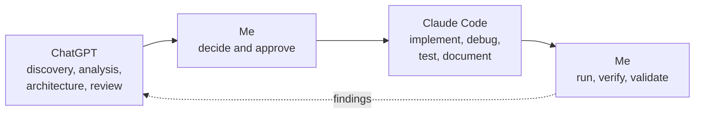

# NexoraFlow — AI Usage, Prompt History & Personal Contribution

**Project:** NexoraFlow — Employee Leave & Expense Workflow Automation System  
**Challenge:** AI Forward Deployed Engineer — YottaFlex.ai  
**Technology:** Java 21, Spring Boot, PostgreSQL, Maven, Flyway and Docker

---

# 1. Purpose of AI Usage

I used Large Language Models (LLMs) as engineering and analytical assistants throughout the planning and development of NexoraFlow.

My objective was not to delegate the entire project to AI, but to use it to accelerate business analysis, technical research, architecture planning, implementation, debugging, testing and documentation.

I maintained responsibility for understanding the challenge, selecting the final technical direction, reviewing AI-generated recommendations and validating the resulting solution.

I used two primary AI tools, with different responsibilities:

| AI Tool | Primary responsibility |
|---|---|
| ChatGPT (GPT-6) | Business analysis, understanding requirements, FDE planning, architecture discussions, technical reasoning and independent review |
| Claude Code | Repository inspection, project implementation, code modification, debugging, testing assistance and documentation |

I acted as the decision owner. AI-generated suggestions were treated as recommendations or implementation assistance, not automatically accepted as correct.

# 2. Planning and Business Analysis — GPT Prompt History

The following entries describe the planning interactions that helped me understand the challenge and establish the technical direction.

**Important:** These are reconstructed descriptions of the planning prompts based on the available conversation history, not verbatim exports of every original conversation.

## AI-001 — Challenge Analysis and Requirement Breakdown

**AI Tool:** ChatGPT (GPT-6)  
**FDE Stage:** Discovery and Business Analysis  
**Objective:** Understand the challenge and convert its requirements into an actionable project scope.

### Prompt Used

```text
Analyze this employee leave and expense workflow automation challenge in detail.

Identify the business problem, stakeholders, required workflows, core entities, dependencies, business rules, approval processes, exceptions, data requirements, and evaluation criteria.

Explain what needs to be built, what is mandatory, and what can be considered optional.

Approach this as a Forward Deployed Engineer rather than simply a backend developer.

Help me understand the business requirements before selecting an implementation approach.
```

### AI Contribution

- Structured the challenge into functional areas.
- Identified the core business entities.
- Explained the relationships between master data and transaction records.
- Identified leave and expense workflows.
- Highlighted approval routing and reimbursement requirements.
- Identified exception scenarios and evaluation requirements.

### Where AI Accelerated My Work

It converted a lengthy challenge description into structured requirements, reducing the effort needed to manually organize the problem.

### Where I Relied Heavily on AI

I relied on AI for the initial requirements breakdown, identification of system components and organization of business scenarios.

### What I Personally Reviewed

- The original challenge statement.
- The relevance of each proposed feature.
- The relationships between required data entities.
- The expected business outcomes.

### What I Personally Changed

I kept the scope focused on employee leave, expenses, approvals, policy validation, auditability and measurable outcomes rather than expanding it into a generic HR management platform.

**Final Decision:** Modified and accepted.

**Evidence:** Challenge requirements analysis and project scope.

---

## AI-002 — Technology Stack Evaluation

**AI Tool:** ChatGPT (GPT-6)  
**FDE Stage:** Technical Decision-Making  
**Objective:** Select an appropriate technology stack for the 72-hour challenge.

### Prompt Used

```text
Recommend a suitable database and technology stack for this employee leave and expense workflow automation system.

Compare Java with Spring Boot against Node.js.

Consider my existing backend development experience, development speed, relational data requirements, business logic complexity, maintainability, and the 72-hour deadline.

Explain why one approach would be more suitable than the other.

Also recommend an appropriate architecture without introducing unnecessary complexity.
```

### AI Contribution

- Compared Java/Spring Boot and Node.js.
- Evaluated relational database requirements.
- Explained the benefits of PostgreSQL.
- Recommended a modular monolith.
- Suggested Flyway, JPA, Maven, Docker and automated testing.

### Where AI Accelerated My Work

AI organized the technology trade-offs and helped me evaluate the options without spending excessive time researching every alternative.

### Where I Relied Heavily on AI

I relied on AI for comparative analysis and technical justification.

### What I Personally Reviewed

- My existing experience with Java and Spring Boot.
- The challenge deadline.
- The need for transactions and relational integrity.
- The complexity of approval workflows.

### What I Personally Changed

I retained Java 21, Spring Boot and PostgreSQL as the project's technology direction rather than switching to a new backend stack during the challenge.

I also retained the modular monolith architecture.

**Final Decision:** Modified and accepted.

**Evidence:** Selected technology stack and architecture constraints.

---

## AI-003 — Understanding the Forward Deployed Engineer Role

**AI Tool:** ChatGPT (GPT-6)  
**FDE Stage:** FDE Methodology and Solution Planning  
**Objective:** Understand how to execute the project as a Forward Deployed Engineer.

### Prompt Used

```text
Explain how a Forward Deployed Engineer would approach this project.

I do not want to approach it only as a backend development assignment.

Explain the complete FDE lifecycle, starting from understanding the customer's business problem through discovery, process analysis, business rules, architecture, implementation, integration, testing, deployment, and customer handover.

Explain what an FDE should personally do at each stage and what deliverables should be produced.

Also explain how I should use AI tools throughout this process.
```

### AI Contribution

AI introduced a structured FDE lifecycle:

1. Customer discovery.
2. Stakeholder analysis.
3. AS-IS workflow analysis.
4. TO-BE workflow design.
5. Business rule definition.
6. Architecture design.
7. Data strategy.
8. Implementation.
9. Exception handling.
10. User acceptance testing.
11. Deployment.
12. Customer demonstration and handover.

### Where AI Accelerated My Work

It helped me understand the broader responsibilities of an FDE and organize the project around business outcomes instead of starting directly with code.

### Where I Relied Heavily on AI

I relied on AI to structure the FDE lifecycle and identify the deliverables associated with each stage.

### What I Personally Reviewed

I reviewed the proposed workflow against the challenge requirements and the time available.

### What I Personally Changed

I adopted a business-first approach: understand the workflow and business rules before implementing the backend.

**Final Decision:** Accepted.

**Evidence:** FDE execution methodology.

---

## AI-004 — Architecture and Scope Control

**AI Tool:** ChatGPT (GPT-6)  
**FDE Stage:** Solution Architecture  
**Objective:** Establish a practical architecture and avoid unnecessary engineering complexity.

### Prompt Used

```text
Design an appropriate architecture for NexoraFlow within a 72-hour challenge.

Use Java, Spring Boot, and PostgreSQL.

Explain the required modules, their responsibilities, relationships, and boundaries.

Consider leave management, expense management, policies, approvals, reimbursement, audit history, synthetic data generation, and evaluation.

Identify technologies that are genuinely necessary and technologies that would introduce unnecessary complexity.

Keep the architecture maintainable, explainable, and suitable for demonstration.
```

### AI Contribution

AI proposed:

- Modular monolith architecture.
- Separate business modules.
- Explicit audit and workflow events.
- Deterministic business rules.
- Independent ground-truth evaluation.
- Docker-based deployment.
- Automated testing.

It also recommended avoiding unnecessary microservices and distributed infrastructure.

### Where AI Accelerated My Work

AI helped establish architectural boundaries and prioritize the components needed to deliver a working solution.

### Where I Relied Heavily on AI

I relied on AI for architecture exploration and module organization.

### What I Personally Reviewed

I considered implementation complexity, the challenge timeline and the usefulness of additional infrastructure.

### What I Personally Changed

I retained a modular monolith and avoided introducing unnecessary technologies such as Kafka, RabbitMQ, Kubernetes, Redis and Elasticsearch without a genuine requirement.

I also decided that AI should not make final approval decisions. Business decisions should follow explicit, deterministic rules.

**Final Decision:** Modified and accepted.

**Evidence:** Project architecture constraints.

---

## AI-005 — Synthetic Data and Ground-Truth Planning

**AI Tool:** ChatGPT (GPT-6)  
**FDE Stage:** Data Engineering and Evaluation Design  
**Objective:** Determine how to create realistic synthetic company data and evaluate the system.

### Prompt Used

```text
Explain how I should create realistic fictional company data for this challenge.

Determine whether I should generate the data myself or use external datasets.

Design a synthetic data strategy covering employees, reporting hierarchy, leave policies, leave balances, expense claims, expense lines, cost centers, approval rules, and reimbursements.

Explain how to create realistic anomalies and maintain data integrity.

Also explain how to create an independent ground-truth dataset for evaluating business decisions.
```

### AI Contribution

AI recommended deterministic synthetic data generation with a fixed seed.

It proposed an initial dataset of:

- 400 employees.
- 6 leave policies.
- 800 leave requests.
- 1,000 expense claims.
- 1–10 expense lines per claim.

It also suggested generating parent records before dependent records, preserving referential integrity and maintaining a separate ground-truth dataset.

### Where AI Accelerated My Work

AI helped define the data-generation strategy, identify entity dependencies and organize the evaluation approach.

### Where I Relied Heavily on AI

I relied on AI for the initial data-generation design, anomaly scenarios and ground-truth structure.

### What I Personally Reviewed

I reviewed the proposed data volumes, relationships and anomaly scenarios for relevance to the challenge.

### What I Personally Changed

I adopted synthetic data generation rather than depending on private company records.

I also retained the separation between ground truth and the decision engine.

**Final Decision:** Accepted.

**Evidence:** Data generation and evaluation plan.

---

## AI-006 — FDE Prompt Workflow and AI Productivity

**AI Tool:** ChatGPT (GPT-6)  
**FDE Stage:** AI-Assisted Development Planning  
**Objective:** Establish a structured prompt workflow for executing the project with AI.

### Prompt Used

```text
As an FDE working on this challenge, create a structured collection of prompts that I should use throughout the project.

Cover customer discovery, stakeholder interviews, requirements, AS-IS and TO-BE workflows, business rules, architecture, database design, synthetic data generation, implementation, code review, debugging, testing, deployment, documentation, and customer handover.

Explain which prompts should be used with GPT and which should be used with Claude Code.

Ensure the workflow helps me retain ownership of decisions while using AI to accelerate development.
```

### AI Contribution

AI created a phased prompt workflow and divided responsibilities between planning, analysis, implementation and review.

### Where AI Accelerated My Work

It converted the project into smaller tasks with reusable prompts, reducing the time needed to formulate instructions and repeatedly explain the project context.

### Where I Relied Heavily on AI

I relied on AI for the prompt framework, activity sequencing and suggestions for dividing work between AI tools.

### What I Personally Reviewed

I reviewed whether the prompts represented actual FDE responsibilities and whether they were suitable for the project timeline.

### What I Personally Changed

I established this working approach:

- GPT for discovery, analysis, architecture and independent review.
- Claude Code for repository inspection, implementation, debugging and test assistance.
- Myself as the final decision owner.

**Final Decision:** Modified and accepted.

**Evidence:** FDE prompt workflow.

---

# 3. Actual Claude Code Development History

The following seven entries are the prompts actually supplied during the development and documentation process. Their original wording is preserved.

## P1 — Starting the Project

**Date:** 12 November 2026, 09:04 IST  
**AI Tool:** Claude Code  
**FDE Stage:** Initial Implementation

### Prompt Used

```text
now read this .txt file and create this project also think about it properly... and create this project properly and if you like you can add extra things in it but they have to be reasonable and worklong as per the task
```

### Objective

Understand the supplied project requirements and begin building NexoraFlow.

### Why I Used It

I wanted Claude Code to understand the assignment before starting implementation. I allowed reasonable improvements, but only if they supported the actual business problem.

### AI Contribution

Initial project implementation and suggestions for relevant functionality.

### What I Personally Reviewed

Whether the proposed implementation and additional features were relevant to the assignment.

---

## P2 — Continuing Implementation

**Date:** 12 November 2026, 09:26 IST  
**AI Tool:** Claude Code  
**FDE Stage:** Implementation

### Prompt Used

```text
continue from where you left and create the project
```

### Objective

Continue the existing implementation without restarting the project.

### Why I Used It

The initial implementation was not complete, so I asked Claude Code to continue from its existing state.

### AI Contribution

Continuation of project development.

### What I Personally Reviewed

Whether the existing implementation was being preserved and the remaining functionality was being addressed.

---

## P3 — Resuming Development

**Date:** 12 November 2026, 23:47 IST  
**AI Tool:** Claude Code  
**FDE Stage:** Implementation

### Prompt Used

```text
continue from where you left
```

### Objective

Resume development after an interruption.

### Why I Used It

I wanted to continue the existing work without repeating completed tasks.

### AI Contribution

Continuation of the existing project work.

### What I Personally Reviewed

The state of the implementation and the work still remaining.

---

## P4 — Checking Completion and Preparing Documentation

**Date:** 13 November 2026, 01:29 IST  
**AI Tool:** Claude Code  
**FDE Stage:** Verification and Documentation

### Prompt Used

```text
did the project is completely done.... as per the assignment needed .... if everything is done then create a proper readme.md file  with proper digrams and design....  also create a prompt file where i have used the prompts to design this application which prompts i use and why which llm use for what and think that as a Forward deployed enginner don't and prompts must be reasonable... not the entire project made from  AI and where i use claude and gpt also mention that
```

### Objective

Check assignment completion and prepare project documentation.

### Why I Used It

I wanted to determine whether the implementation met the assignment requirements and document the system architecture and AI usage.

### AI Contribution

Assistance with implementation review and preparation of project documentation.

### What I Personally Reviewed

Whether the documentation accurately represented the project and whether the implementation addressed the challenge.

---

## P5 — Documenting the FDE Approach

**Date:** 13 November 2026, 09:39 IST  
**AI Tool:** Claude Code  
**FDE Stage:** Documentation and AI Transparency

### Prompt Used

```text
create a prompt file in which i have to thinks  as a forward deployed emgineer and use my prompts and create this project, i use gpt for explaian the project to me more clearly... and i'm providing the idea how you have to write that file "LLM tools are allowed. Submit your prompt history and explain where AI accelerated
your work, where you relied heavily on it, and what you personally reviewed,
changed, or validated."
```

### Objective

Document how AI supported the work while retaining personal engineering responsibility.

### Why I Used It

The assignment allowed LLM tools but expected transparency about their use. I wanted to document where AI accelerated development and where I personally made decisions.

### AI Contribution

Assistance in organizing the AI usage explanation and prompt history.

### What I Personally Reviewed

Whether the documentation reflected my actual use of GPT and Claude Code.

---

## P6 — Improving Documentation Accuracy

**Date:** 13 November 2026, 12:04 IST  
**AI Tool:** Claude Code  
**FDE Stage:** Documentation Review

### Prompt Used

```text
can you improve this prompt.md file in view... also also no need to add my actual prompts in this file keep that in mind also add the details about the project in it  where needed or asked for and check these prompts are they good also these prompts which were they asking are available in our present project if no then remove those prompts and modify these prompts so they are not look like ai generated
```

### Objective

Improve documentation and ensure that it reflects the actual implementation.

### Why I Used It

I did not want to document features or capabilities that were not present in the application.

### AI Contribution

Documentation editing and assistance with comparing documented features against the implementation.

### What I Personally Reviewed

Whether the documented functionality was relevant and supported by the actual project.

---

## P7 — Preparing the Final Prompt Log

**Date:** 13 November 2026, 12:23 IST  
**AI Tool:** Claude Code  
**FDE Stage:** Final Documentation

### Prompt Used

```text
improve the view of this .md file also check is this project have all that things that we have talkid in this prompts if no then remove those prompts and create a prompt-log.md fiile in docs which contain these prompts but in a better humen version form
```

### Objective

Prepare a readable prompt log and align the documentation with the project.

### Why I Used It

I wanted a separate document containing the prompts and their purpose, without making unsupported claims about the implementation.

### AI Contribution

Markdown organization, documentation improvements and assistance with the prompt log.

### What I Personally Reviewed

The final structure, accuracy and consistency of the documentation.

---

# 4. Implementation Prompt Library

This section contains structured prompts for repository-level engineering tasks. They are intended to document implementation work when actually used.

**Important:** These are implementation prompt templates, not proof that every prompt was submitted to Claude Code or that every described activity was completed. Retain an entry as historical usage only when there is evidence that the prompt was actually used.

## AI-007 — Repository Setup and Inspection

**AI Tool:** Claude Code  
**FDE Stage:** Implementation  
**Objective:** Inspect the repository and establish the backend project structure.

### Prompt

```text
Inspect my NexoraFlow repository and understand its existing structure.

The project uses Java 21, Spring Boot, PostgreSQL, Maven, and Flyway.

Identify existing files, dependencies, configurations, and incomplete components.

Propose a clean modular monolith structure covering employee, leave, expense, approval, reimbursement, audit, generator, and evaluation modules.

Do not overwrite existing code. First provide an implementation plan.
```

### AI Contribution

Repository analysis, project structure recommendations and setup guidance.

### Where AI Accelerated My Work

Reduced manual repository inspection and project setup planning.

### What I Personally Reviewed

Package structure, dependencies, module boundaries and alignment with the approved architecture.

### Personal Responsibility

Approve the structure before implementation.

### Evidence to Record

Repository structure, setup changes and relevant commit.

---

## AI-008 — Database and Entity Implementation

**AI Tool:** Claude Code  
**FDE Stage:** Backend Implementation  
**Objective:** Implement the relational data model.

### Prompt

```text
Implement the approved NexoraFlow database entities and relationships.

Use Spring Data JPA and PostgreSQL.

Include primary keys, foreign keys, validation constraints, appropriate indexes, and relationships.

Create Flyway migrations for schema changes.

Follow the approved database design. Do not invent business fields or modify unrelated modules.

Explain the relationships and report the files created or modified.
```

### AI Contribution

Entity, repository, relationship and migration implementation assistance.

### Where AI Accelerated My Work

Reduced repetitive entity and persistence-layer coding.

### What I Personally Reviewed

Entity relationships, foreign keys, constraints and schema consistency.

### What I Personally Validated

Migration execution and database integrity checks, when performed.

### Evidence to Record

Migration files, entity classes and database test results.

---

## AI-009 — Business Workflow Implementation

**AI Tool:** Claude Code  
**FDE Stage:** Core Implementation  
**Objective:** Implement leave, expense and approval workflows.

### Prompt

```text
Implement the approved NexoraFlow business workflows.

Start with leave management, followed by expense management and approval routing.

Implement:

- Request validation
- Leave balance calculations
- Business-day calculations
- Expense total calculations
- Policy validation
- Duplicate detection
- Approval routing
- Workflow state transitions
- Audit events
- Reimbursement eligibility

Follow the documented business rules.

Use DTOs, services, repositories, transactions, and appropriate validation.

Implement only the requested module and add relevant tests.

Report implemented rules, modified files, and remaining limitations.
```

### AI Contribution

Business service implementation, validation logic and workflow coding assistance.

### Where AI Accelerated My Work

Helped translate documented rules into service-layer code and reduced repetitive implementation work.

### What I Personally Reviewed

Business conditions, calculations, approval authority and state transitions.

### What I Personally Changed

Any generated logic that did not match the approved requirements.

### Evidence to Record

Service implementations, business rule definitions and corresponding tests.

---

## AI-010 — Synthetic Data Generator Implementation

**AI Tool:** Claude Code  
**FDE Stage:** Data Engineering  
**Objective:** Implement reproducible company data generation.

### Prompt

```text
Implement a deterministic synthetic data generator for NexoraFlow.

Generate master data before dependent transaction records.

Use a configurable fixed seed and support configurable dataset sizes.

Generate employees, hierarchy, policies, leave balances, leave requests, expense claims, expense lines, approval records, and supporting data.

Ensure referential integrity and calculate derived values instead of generating them independently.

Generate ground-truth records separately from the decision engine.

Provide CSV or JSON exports and a validation summary.
```

### AI Contribution

Generator implementation assistance, synthetic record creation and export logic.

### Where AI Accelerated My Work

Reduced the effort required to create repetitive synthetic records and data-generation logic.

### What I Personally Reviewed

Generation dependencies, record relationships, realistic scenarios and ground-truth separation.

### What I Personally Validated

Fixed-seed reproducibility, record counts, foreign keys and derived calculations, when executed.

### Evidence to Record

Generator source code, generated datasets and validation reports.

---

## AI-011 — Debugging and Refinement

**AI Tool:** Claude Code and ChatGPT  
**FDE Stage:** Debugging and Quality Improvement  
**Objective:** Identify and resolve implementation problems.

### Prompt

```text
Analyze the following NexoraFlow implementation issue:

[ACTUAL ERROR OR UNEXPECTED BEHAVIOR]

Inspect the relevant code and identify the likely root cause.

Explain the execution path, suggest the smallest safe fix, identify regression risks, and propose a test to prevent the issue from recurring.

Do not make unrelated changes.
```

### AI Contribution

Error analysis, root-cause hypotheses and suggested fixes.

### Where AI Accelerated My Work

Reduced time spent exploring possible causes and identifying relevant code paths.

### What I Personally Reviewed

The suggested root cause and the impact of the proposed fix.

### What I Personally Validated

Reproduced the issue and verified the fix through the relevant test or execution result, when performed.

### Evidence to Record

Actual bug report, code change and test result.

---

## AI-012 — Automated Testing and Independent Review

**AI Tool:** ChatGPT and Claude Code  
**FDE Stage:** Testing and Quality Assurance  
**Objective:** Verify business logic and identify missing scenarios.

### Prompt

```text
Review the NexoraFlow implementation against its approved business rules.

Identify missing test cases and potential failures involving:

- Insufficient leave balance
- Overlapping leave
- Expense policy violations
- Duplicate receipts
- Incorrect approval routing
- Unauthorized approvals
- Invalid workflow transitions
- Duplicate reimbursement
- Ground-truth mismatches

Generate appropriate unit and integration tests.

Run the tests where possible and report actual results.

Do not claim that a test passes unless it has been executed successfully.
```

### AI Contribution

Test scenario generation, test implementation assistance and code review.

### Where AI Accelerated My Work

Helped identify boundary conditions and create a broader testing checklist.

### What I Personally Reviewed

Expected business outcomes and whether tests reflected the actual requirements.

### What I Personally Validated

Test execution, failures, corrections and expected-versus-actual results.

### Evidence to Record

Test source files and actual test reports.

---

## AI-013 — Final Implementation Review

**AI Tool:** ChatGPT and Claude Code  
**FDE Stage:** Quality Assurance and Submission Preparation  
**Objective:** Review the completed implementation against the challenge requirements.

### Prompt

```text
Perform a final technical review of NexoraFlow.

Compare the actual repository with the approved challenge requirements.

Check:

- Database integrity
- Business rules
- Leave and expense calculations
- Approval routing
- Audit history
- Reimbursement eligibility
- Synthetic data reproducibility
- Ground-truth separation
- Exception handling
- Automated tests
- Docker deployment
- Documentation

Create a requirement-to-evidence matrix.

Classify every requirement as verified, partially implemented, not implemented, or not applicable.

Do not mark anything complete without supporting evidence.
```

### AI Contribution

Requirement gap analysis, implementation review and final quality checklist.

### Where AI Accelerated My Work

Reduced manual review effort and helped organize remaining work by priority.

### What I Personally Reviewed

Critical findings, implementation status and challenge compliance.

### What I Personally Validated

Actual repository contents, test results, deployment behavior and submission evidence.

### Evidence to Record

Final review report and verified repository artifacts.

---

# 5. Post-Build Verification Prompts

**Prepared:** 13 November 2026  
**AI Tool:** Claude Code  
**Status:** These prompts were prepared after the initial build for deeper verification. They should not be represented as historical implementation prompts or completed tests unless actually executed.

The purpose is to inspect the application beyond whether its endpoints respond successfully. The checks focus on business correctness, authorization, transaction safety, configurability and test quality.

## R1 — Trace a Leave Request from API to Database

### Prompt

```text
Take one leave request and trace it through the actual codebase from beginning to end.

Use an example where an employee requests 5 working days of leave but has only 3 days available.

Show me exactly what happens:

- Which API endpoint receives the request?
- Which controller handles it?
- Which service processes it?
- Which business rules are evaluated?
- Which database tables are read or changed?
- What status does the request receive?
- Which audit or workflow events are recorded?

Use actual class names, file paths, method names and rule identifiers from the repository. Do not give me a theoretical explanation. If something is not implemented, say so clearly.
```

**Purpose:** Verify the complete leave-request lifecycle and the handling of insufficient leave balance.

**Evidence to collect:** Actual execution path, relevant code, database records and test output.

## R2 — Check Whether Approval Rules Can Be Bypassed

### Prompt

```text
Review the approval workflow carefully. I want to know whether the system prevents the following situations:

1. An employee approving their own request.
2. An approver completing the second approval step before the first one.
3. The same approval step being approved more than once.
4. An inactive or unauthorized employee acting as an approver.

For each case, inspect the actual implementation and explain whether it is prevented by Java business logic, database constraints, triggers, or not prevented at all.

Show the relevant code and existing tests. If a protection is missing, explain the risk and add an appropriate test before suggesting a fix.
```

**Purpose:** Verify approval authority, approval order and duplicate-action protection.

**Evidence to collect:** Relevant implementation, constraints and tests.

## R3 — Test Duplicate Reimbursement Protection

### Prompt

```text
Review the reimbursement workflow and try to identify ways a duplicate reimbursement could happen.

Consider:

- Two requests arriving at almost the same time.
- A client retrying after a timeout.
- A failure occurring after the reimbursement record is created.
- Someone attempting to reimburse an already paid claim again.

Inspect the actual transaction boundaries, database constraints, idempotency handling and service logic.

Explain what happens in each scenario. If duplicate reimbursement is possible, demonstrate the weakness with a test and recommend a fix that preserves the existing business rules.
```

**Purpose:** Verify reimbursement safety against retries, concurrency and repeated requests.

**Evidence to collect:** Transaction boundaries, database constraints and concurrency test results.

## R4 — Verify Assignment Requirements Against the Implementation

### Prompt

```text
Review the project against the original assignment requirements, especially sections 14 and 15.

Go through each requirement individually.

For every requirement, provide:

- The exact requirement.
- The relevant implementation file, class or database table.
- The business logic that supports it.
- The test or evidence proving it works.
- Its current status: implemented, partially implemented, missing or not verified.

Do not mark a requirement as complete just because a related class or table exists. Verify the actual behaviour.

Do not invent implementation evidence. If something is missing, identify it honestly.
```

**Purpose:** Establish actual assignment coverage using implementation evidence rather than assumptions.

**Evidence to collect:** Requirement-to-code mapping and test results.

## R5 — Check Whether Approval Rules Are Configurable

### Prompt

```text
Assume the business wants to change the manager approval limit from $500 to $1,000, effective tomorrow.

I want to understand whether this change can be made without modifying Java code.

Inspect the actual approval-rule implementation and demonstrate:

- Where the existing threshold is stored.
- How the effective date is represented.
- How the new rule would be added.
- Whether requests created before the change retain their original approval history.
- How requests created after the effective date use the new threshold.
- Whether the rule configuration is validated.

Use the actual project structure and database schema. If the current system does not support effective-dated configuration, explain what is missing instead of pretending it does.
```

**Purpose:** Evaluate rule configurability and preservation of historical decisions.

**Evidence to collect:** Rule configuration, database records and execution results.

## R6 — Evaluate the Strength of Business-Rule Tests

### Prompt

```text
Review the tests for the main business rules in this project.

I want to know whether the tests would detect actual mistakes in the implementation, not just whether they pass.

Work in a disposable branch or a clean working tree.

Temporarily introduce controlled mistakes, such as:

- Reversing a comparison operator in an approval threshold.
- Removing an insufficient-balance check.
- Removing a duplicate-reimbursement check.
- Allowing approval steps to execute out of order.

Run the relevant tests and report which mistakes are detected and which are not.

Add missing tests where necessary. Restore the original implementation and run the complete test suite again.

Do not leave intentional defects in the final code.
```

**Purpose:** Determine whether the test suite can detect defects in important business rules.

**Evidence to collect:** Mutation results, added tests and final successful test execution.

---

# 6. AI Productivity Assessment

## 6.1 Where AI Accelerated My Work

AI provided the greatest productivity improvement during the initial analysis, planning and implementation stages.

| Activity | AI assistance | Productivity benefit |
|---|---|---|
| Challenge analysis | Structured requirements | Reduced manual organization |
| Technology evaluation | Compared alternatives | Faster decision-making |
| FDE methodology | Organized lifecycle | Clearer execution plan |
| Architecture | Suggested modules and boundaries | Faster design exploration |
| Data strategy | Identified dependencies and anomalies | Faster planning |
| Repository inspection | Analyzed existing structure | Reduced manual inspection |
| Backend implementation | Assisted with code creation | Reduced repetitive coding |
| Debugging | Suggested root causes | Faster investigation |
| Testing | Generated test scenarios | Broader test coverage planning |
| Documentation | Organized technical explanations | Faster documentation preparation |

## 6.2 Where I Relied Heavily on AI

During planning, I relied heavily on AI for:

- First drafts of requirements analysis.
- Architecture exploration.
- FDE workflow structuring.
- Business process analysis.
- Synthetic data planning.
- Prompt design.

During implementation, Claude Code was used extensively to assist with repository-level work and code changes.

These outputs were treated as starting points, not automatically accepted as final decisions.

## 6.3 What I Personally Reviewed and Changed

I retained ownership of the following decisions:

- Selecting Java and Spring Boot based on my existing experience.
- Choosing PostgreSQL for relational consistency.
- Retaining a modular monolith.
- Prioritizing backend business workflows.
- Avoiding unnecessary infrastructure.
- Keeping business decisions deterministic.
- Maintaining ground-truth independence.
- Defining the sequence of project execution.

I reviewed AI recommendations against the challenge requirements and modified the proposed approach to fit the project scope and deadline.

## 6.4 What I Personally Validated

The validation responsibilities included:

- Requirements against the original challenge statement.
- Technology choices against project constraints.
- Architecture against the available development time.
- Data dependencies against the relational model.
- Approval routing against business rules.
- Reimbursement eligibility against workflow state.# NexoraFlow — AI Usage and Prompt Log

| | |
|---|---|
| **Project** | NexoraFlow — Employee Leave & Expense Workflow Automation System |
| **Challenge** | AI Forward Deployed Engineer — YottaFlex.ai |
| **Stack** | Java 21 · Spring Boot · PostgreSQL · Maven · Flyway · Docker |
| **AI tools** | ChatGPT (GPT-6) · Claude Code |
| **Last updated** | 13 November 2026 |

> **In one line:** AI helped me move faster. I stayed responsible for deciding what to build, why to build it, and whether the result meets the requirements.

## Contents

1. [How I used AI](#1-how-i-used-ai)
2. [How to read this log](#2-how-to-read-this-log)
3. [Planning history with ChatGPT](#3-planning-history-with-chatgpt)
4. [Claude Code development history](#4-claude-code-development-history)
5. [Implementation prompt library](#5-implementation-prompt-library)
6. [Post-build verification prompts](#6-post-build-verification-prompts)
7. [AI productivity assessment](#7-ai-productivity-assessment)
8. [AI involvement vs. my responsibility](#8-ai-involvement-vs-my-responsibility)
9. [Limitations and open evidence](#9-limitations-and-open-evidence)

---

## 1. How I used AI

I used large language models as engineering and analysis assistants while planning and building NexoraFlow. They helped me move faster on business analysis, technical research, architecture planning, implementation, debugging, testing and documentation.

I did not hand the project over to AI. I understood the challenge myself, chose the technical direction, reviewed what the AI suggested, and validated the result. Every AI suggestion was treated as a recommendation or as implementation help, never as automatically correct.

### Two tools, two roles

| Tool | What I used it for |
|---|---|
| **ChatGPT (GPT-6)** | Business analysis, understanding requirements, FDE planning, architecture discussions, technical reasoning, independent review |
| **Claude Code** | Repository inspection, implementation, code changes, debugging, testing help, documentation |

### Working model



---

## 2. How to read this log

Not every entry here carries the same weight as evidence. Each section is labelled so the difference stays clear.

| Section | What it contains | Status |
|---|---|---|
| [3. Planning history](#3-planning-history-with-chatgpt) | Descriptions of the GPT planning conversations (AI-001 to AI-006) | **Reconstructed.** Rebuilt from the conversation history, not exported word for word |
| [4. Claude Code history](#4-claude-code-development-history) | The seven prompts I actually gave Claude Code (P1 to P7) | **Verbatim.** Original wording kept, including typos |
| [5. Implementation prompt library](#5-implementation-prompt-library) | Structured prompts for repository-level work (AI-007 to AI-013) | **Templates.** Not proof that each prompt was submitted or each task completed |
| [6. Post-build verification prompts](#6-post-build-verification-prompts) | Deeper checks prepared after the first build (R1 to R6) | **Prepared, not executed.** Not completed tests |

Planned validation and completed validation are kept separate throughout. Only checks that were actually run should be reported as done.

---

## 3. Planning history with ChatGPT

These entries describe how I used ChatGPT to understand the challenge and settle the technical direction. They are reconstructed from the available conversation history. They are not verbatim exports.

### AI-001 — Challenge analysis and requirement breakdown

| Tool | FDE stage | Outcome | Evidence |
|---|---|---|---|
| ChatGPT (GPT-6) | Discovery and business analysis | Modified and accepted | Challenge requirements analysis and project scope |

**Objective:** Understand the challenge and turn its requirements into an actionable project scope.

**Prompt**

```text
Analyze this employee leave and expense workflow automation challenge in detail.

Identify the business problem, stakeholders, required workflows, core entities, dependencies, business rules, approval processes, exceptions, data requirements, and evaluation criteria.

Explain what needs to be built, what is mandatory, and what can be considered optional.

Approach this as a Forward Deployed Engineer rather than simply a backend developer.

Help me understand the business requirements before selecting an implementation approach.
```

**What the AI did**

- Structured the challenge into functional areas.
- Identified the core business entities.
- Explained how master data relates to transaction records.
- Identified the leave and expense workflows.
- Highlighted approval routing and reimbursement requirements.
- Identified exception scenarios and evaluation requirements.

| | |
|---|---|
| **Where it sped me up** | Turned a long challenge description into structured requirements, so I spent less time organizing the problem by hand. |
| **Where I relied on it** | The first requirements breakdown, identifying system components, and organizing business scenarios. |
| **What I reviewed** | The original challenge statement; whether each proposed feature was relevant; the relationships between data entities; the expected business outcomes. |
| **What I changed** | Kept the scope on leave, expenses, approvals, policy validation, auditability and measurable outcomes. I did not widen it into a generic HR platform. |

---

### AI-002 — Technology stack evaluation

| Tool | FDE stage | Outcome | Evidence |
|---|---|---|---|
| ChatGPT (GPT-6) | Technical decision-making | Modified and accepted | Selected technology stack and architecture constraints |

**Objective:** Choose a suitable technology stack for the 72-hour challenge.

**Prompt**

```text
Recommend a suitable database and technology stack for this employee leave and expense workflow automation system.

Compare Java with Spring Boot against Node.js.

Consider my existing backend development experience, development speed, relational data requirements, business logic complexity, maintainability, and the 72-hour deadline.

Explain why one approach would be more suitable than the other.

Also recommend an appropriate architecture without introducing unnecessary complexity.
```

**What the AI did**

- Compared Java/Spring Boot with Node.js.
- Evaluated the relational database requirements.
- Explained the benefits of PostgreSQL.
- Recommended a modular monolith.
- Suggested Flyway, JPA, Maven, Docker and automated testing.

| | |
|---|---|
| **Where it sped me up** | Organized the trade-offs so I could compare options without researching every alternative. |
| **Where I relied on it** | The comparative analysis and the technical justification. |
| **What I reviewed** | My own experience with Java and Spring Boot; the challenge deadline; the need for transactions and relational integrity; the complexity of the approval workflows. |
| **What I changed** | Kept Java 21, Spring Boot and PostgreSQL instead of switching stacks mid-challenge. Kept the modular monolith. |

---

### AI-003 — Understanding the Forward Deployed Engineer role

| Tool | FDE stage | Outcome | Evidence |
|---|---|---|---|
| ChatGPT (GPT-6) | FDE methodology and solution planning | Accepted | FDE execution methodology |

**Objective:** Understand how to run this project as a Forward Deployed Engineer.

**Prompt**

```text
Explain how a Forward Deployed Engineer would approach this project.

I do not want to approach it only as a backend development assignment.

Explain the complete FDE lifecycle, starting from understanding the customer's business problem through discovery, process analysis, business rules, architecture, implementation, integration, testing, deployment, and customer handover.

Explain what an FDE should personally do at each stage and what deliverables should be produced.

Also explain how I should use AI tools throughout this process.
```

**What the AI did:** introduced a twelve-step FDE lifecycle.

| # | Stage | # | Stage |
|---|---|---|---|
| 1 | Customer discovery | 7 | Data strategy |
| 2 | Stakeholder analysis | 8 | Implementation |
| 3 | AS-IS workflow analysis | 9 | Exception handling |
| 4 | TO-BE workflow design | 10 | User acceptance testing |
| 5 | Business rule definition | 11 | Deployment |
| 6 | Architecture design | 12 | Customer demonstration and handover |

| | |
|---|---|
| **Where it sped me up** | Showed me the wider FDE responsibilities and let me organize the project around business outcomes instead of starting with code. |
| **Where I relied on it** | Structuring the lifecycle and naming the deliverables for each stage. |
| **What I reviewed** | The proposed workflow against the challenge requirements and the time I had. |
| **What I decided** | Work business-first: understand the workflow and business rules before building the backend. |

---

### AI-004 — Architecture and scope control

| Tool | FDE stage | Outcome | Evidence |
|---|---|---|---|
| ChatGPT (GPT-6) | Solution architecture | Modified and accepted | Project architecture constraints |

**Objective:** Settle on a practical architecture and avoid unnecessary complexity.

**Prompt**

```text
Design an appropriate architecture for NexoraFlow within a 72-hour challenge.

Use Java, Spring Boot, and PostgreSQL.

Explain the required modules, their responsibilities, relationships, and boundaries.

Consider leave management, expense management, policies, approvals, reimbursement, audit history, synthetic data generation, and evaluation.

Identify technologies that are genuinely necessary and technologies that would introduce unnecessary complexity.

Keep the architecture maintainable, explainable, and suitable for demonstration.
```

**What the AI did**

- Proposed a modular monolith with separate business modules.
- Suggested explicit audit and workflow events.
- Suggested deterministic business rules.
- Suggested independent ground-truth evaluation.
- Suggested Docker-based deployment and automated testing.
- Advised against microservices and distributed infrastructure.

| | |
|---|---|
| **Where it sped me up** | Set architectural boundaries and ranked the components needed for a working solution. |
| **Where I relied on it** | Exploring the architecture and organizing the modules. |
| **What I reviewed** | Implementation complexity, the challenge timeline, and whether extra infrastructure was actually useful. |
| **What I changed** | Kept the modular monolith. Left out Kafka, RabbitMQ, Kubernetes, Redis and Elasticsearch because nothing in the project required them. Decided that AI must not make final approval decisions: business decisions follow explicit, deterministic rules. |

---

### AI-005 — Synthetic data and ground-truth planning

| Tool | FDE stage | Outcome | Evidence |
|---|---|---|---|
| ChatGPT (GPT-6) | Data engineering and evaluation design | Accepted | Data generation and evaluation plan |

**Objective:** Decide how to create realistic synthetic company data and how to evaluate the system.

**Prompt**

```text
Explain how I should create realistic fictional company data for this challenge.

Determine whether I should generate the data myself or use external datasets.

Design a synthetic data strategy covering employees, reporting hierarchy, leave policies, leave balances, expense claims, expense lines, cost centers, approval rules, and reimbursements.

Explain how to create realistic anomalies and maintain data integrity.

Also explain how to create an independent ground-truth dataset for evaluating business decisions.
```

**What the AI did:** recommended deterministic synthetic data generation with a fixed seed, and proposed this starting dataset:

| Entity | Initial volume |
|---|---|
| Employees | 400 |
| Leave policies | 6 |
| Leave requests | 800 |
| Expense claims | 1,000 |
| Expense lines | 1–10 per claim |

It also suggested generating parent records before dependent ones, preserving referential integrity, and keeping a separate ground-truth dataset.

| | |
|---|---|
| **Where it sped me up** | Defined the generation strategy, mapped entity dependencies and organized the evaluation approach. |
| **Where I relied on it** | The first data-generation design, the anomaly scenarios and the ground-truth structure. |
| **What I reviewed** | The proposed volumes, relationships and anomaly scenarios, for relevance to the challenge. |
| **What I decided** | Generate synthetic data instead of depending on private company records. Keep ground truth separate from the decision engine. |

---

### AI-006 — FDE prompt workflow and AI productivity

| Tool | FDE stage | Outcome | Evidence |
|---|---|---|---|
| ChatGPT (GPT-6) | AI-assisted development planning | Modified and accepted | FDE prompt workflow |

**Objective:** Set up a structured prompt workflow for running the project with AI.

**Prompt**

```text
As an FDE working on this challenge, create a structured collection of prompts that I should use throughout the project.

Cover customer discovery, stakeholder interviews, requirements, AS-IS and TO-BE workflows, business rules, architecture, database design, synthetic data generation, implementation, code review, debugging, testing, deployment, documentation, and customer handover.

Explain which prompts should be used with GPT and which should be used with Claude Code.

Ensure the workflow helps me retain ownership of decisions while using AI to accelerate development.
```

**What the AI did:** built a phased prompt workflow and divided the work between planning, analysis, implementation and review.

| | |
|---|---|
| **Where it sped me up** | Broke the project into smaller tasks with reusable prompts, so I did not have to keep re-explaining the project context. |
| **Where I relied on it** | The prompt framework, the sequencing of activities, and the split of work between the two tools. |
| **What I reviewed** | Whether the prompts reflected real FDE responsibilities and fit the project timeline. |
| **What I decided** | GPT for discovery, analysis, architecture and independent review. Claude Code for repository inspection, implementation, debugging and test help. Me as the final decision owner. |

---

## 4. Claude Code development history

These are the seven prompts I actually gave Claude Code while building and documenting the project. **The wording is original, typos included.**

### At a glance

| ID | Date (IST) | Stage | Purpose |
|---|---|---|---|
| [P1](#p1--starting-the-project) | 12 Nov 2026, 09:04 | Initial implementation | Read the requirements and start building |
| [P2](#p2--continuing-implementation) | 12 Nov 2026, 09:26 | Implementation | Continue the unfinished build |
| [P3](#p3--resuming-development) | 12 Nov 2026, 23:47 | Implementation | Resume after an interruption |
| [P4](#p4--checking-completion-and-preparing-documentation) | 13 Nov 2026, 01:29 | Verification and documentation | Check completion; start the README and prompt file |
| [P5](#p5--documenting-the-fde-approach) | 13 Nov 2026, 09:39 | Documentation and AI transparency | Document how AI supported the work |
| [P6](#p6--improving-documentation-accuracy) | 13 Nov 2026, 12:04 | Documentation review | Make the docs match the real project |
| [P7](#p7--preparing-the-final-prompt-log) | 13 Nov 2026, 12:23 | Final documentation | Produce the readable prompt log |

### P1 — Starting the project

**12 November 2026, 09:04 IST** · Claude Code · Initial implementation

```text
now read this .txt file and create this project also think about it properly... and create this project properly and if you like you can add extra things in it but they have to be reasonable and worklong as per the task
```

| | |
|---|---|
| **Objective** | Understand the supplied requirements and begin building NexoraFlow. |
| **Why I used it** | I wanted Claude Code to understand the assignment before it started building. I allowed reasonable extras, but only if they served the actual business problem. |
| **AI contribution** | Initial project implementation and suggestions for relevant functionality. |
| **What I reviewed** | Whether the implementation and any extra features were relevant to the assignment. |

---

### P2 — Continuing implementation

**12 November 2026, 09:26 IST** · Claude Code · Implementation

```text
continue from where you left and create the project
```

| | |
|---|---|
| **Objective** | Continue the existing implementation without restarting. |
| **Why I used it** | The first pass was incomplete, so I asked Claude Code to carry on from where it stopped. |
| **AI contribution** | Continued the project build. |
| **What I reviewed** | Whether the existing work was preserved and the remaining functionality was being addressed. |

---

### P3 — Resuming development

**12 November 2026, 23:47 IST** · Claude Code · Implementation

```text
continue from where you left
```

| | |
|---|---|
| **Objective** | Resume development after an interruption. |
| **Why I used it** | I wanted to continue the existing work without repeating finished tasks. |
| **AI contribution** | Continued the existing project work. |
| **What I reviewed** | The state of the implementation and the work still remaining. |

---

### P4 — Checking completion and preparing documentation

**13 November 2026, 01:29 IST** · Claude Code · Verification and documentation

```text
did the project is completely done.... as per the assignment needed .... if everything is done then create a proper readme.md file  with proper digrams and design....  also create a prompt file where i have used the prompts to design this application which prompts i use and why which llm use for what and think that as a Forward deployed enginner don't and prompts must be reasonable... not the entire project made from  AI and where i use claude and gpt also mention that
```

| | |
|---|---|
| **Objective** | Check whether the assignment was fully met, then prepare the documentation. |
| **Why I used it** | I wanted to know whether the implementation met the requirements, and to document the architecture and my AI usage. |
| **AI contribution** | Help reviewing the implementation and preparing the documentation. |
| **What I reviewed** | Whether the documentation represented the project accurately and whether the implementation addressed the challenge. |

---

### P5 — Documenting the FDE approach

**13 November 2026, 09:39 IST** · Claude Code · Documentation and AI transparency

```text
create a prompt file in which i have to thinks  as a forward deployed emgineer and use my prompts and create this project, i use gpt for explaian the project to me more clearly... and i'm providing the idea how you have to write that file "LLM tools are allowed. Submit your prompt history and explain where AI accelerated
your work, where you relied heavily on it, and what you personally reviewed,
changed, or validated."
```

| | |
|---|---|
| **Objective** | Document how AI supported the work while I kept engineering responsibility. |
| **Why I used it** | The assignment allowed LLM tools but expected transparency. I wanted to show where AI sped up development and where I made the decisions. |
| **AI contribution** | Help organizing the AI usage explanation and prompt history. |
| **What I reviewed** | Whether the documentation reflected how I really used GPT and Claude Code. |

---

### P6 — Improving documentation accuracy

**13 November 2026, 12:04 IST** · Claude Code · Documentation review

```text
can you improve this prompt.md file in view... also also no need to add my actual prompts in this file keep that in mind also add the details about the project in it  where needed or asked for and check these prompts are they good also these prompts which were they asking are available in our present project if no then remove those prompts and modify these prompts so they are not look like ai generated
```

| | |
|---|---|
| **Objective** | Improve the documentation and make sure it reflects the actual implementation. |
| **Why I used it** | I did not want to document features the application does not have. |
| **AI contribution** | Documentation editing and help comparing the documented features against the implementation. |
| **What I reviewed** | Whether the documented functionality was relevant and backed by the actual project. |

---

### P7 — Preparing the final prompt log

**13 November 2026, 12:23 IST** · Claude Code · Final documentation

```text
improve the view of this .md file also check is this project have all that things that we have talkid in this prompts if no then remove those prompts and create a prompt-log.md fiile in docs which contain these prompts but in a better humen version form
```

| | |
|---|---|
| **Objective** | Produce a readable prompt log and align the documentation with the project. |
| **Why I used it** | I wanted a separate document with the prompts and their purpose, without unsupported claims about the implementation. |
| **AI contribution** | Markdown organization, documentation improvements and help with the prompt log. |
| **What I reviewed** | The final structure, accuracy and consistency of the documentation. |

---

## 5. Implementation prompt library

> **Status: templates.** These are structured prompts for repository-level engineering work. They are not proof that every prompt was submitted to Claude Code or that every described task was completed. Keep an entry as historical usage only when there is evidence it was actually used.

| ID | Task | Tools |
|---|---|---|
| [AI-007](#ai-007--repository-setup-and-inspection) | Repository setup and inspection | Claude Code |
| [AI-008](#ai-008--database-and-entity-implementation) | Database and entity implementation | Claude Code |
| [AI-009](#ai-009--business-workflow-implementation) | Business workflow implementation | Claude Code |
| [AI-010](#ai-010--synthetic-data-generator-implementation) | Synthetic data generator | Claude Code |
| [AI-011](#ai-011--debugging-and-refinement) | Debugging and refinement | Claude Code and ChatGPT |
| [AI-012](#ai-012--automated-testing-and-independent-review) | Automated testing and independent review | ChatGPT and Claude Code |
| [AI-013](#ai-013--final-implementation-review) | Final implementation review | ChatGPT and Claude Code |

### AI-007 — Repository setup and inspection

**Claude Code** · Implementation · **Objective:** Inspect the repository and establish the backend project structure.

```text
Inspect my NexoraFlow repository and understand its existing structure.

The project uses Java 21, Spring Boot, PostgreSQL, Maven, and Flyway.

Identify existing files, dependencies, configurations, and incomplete components.

Propose a clean modular monolith structure covering employee, leave, expense, approval, reimbursement, audit, generator, and evaluation modules.

Do not overwrite existing code. First provide an implementation plan.
```

| | |
|---|---|
| **AI contribution** | Repository analysis, project structure recommendations and setup guidance. |
| **Where it speeds me up** | Less manual repository inspection and setup planning. |
| **What I review** | Package structure, dependencies, module boundaries, and fit with the approved architecture. |
| **My responsibility** | Approve the structure before implementation starts. |
| **Evidence to record** | Repository structure, setup changes and the relevant commit. |

---

### AI-008 — Database and entity implementation

**Claude Code** · Backend implementation · **Objective:** Implement the relational data model.

```text
Implement the approved NexoraFlow database entities and relationships.

Use Spring Data JPA and PostgreSQL.

Include primary keys, foreign keys, validation constraints, appropriate indexes, and relationships.

Create Flyway migrations for schema changes.

Follow the approved database design. Do not invent business fields or modify unrelated modules.

Explain the relationships and report the files created or modified.
```

| | |
|---|---|
| **AI contribution** | Help with entities, repositories, relationships and migrations. |
| **Where it speeds me up** | Less repetitive entity and persistence-layer coding. |
| **What I review** | Entity relationships, foreign keys, constraints and schema consistency. |
| **What I validate** | Migration execution and database integrity checks, when performed. |
| **Evidence to record** | Migration files, entity classes and database test results. |

---

### AI-009 — Business workflow implementation

**Claude Code** · Core implementation · **Objective:** Implement the leave, expense and approval workflows.

```text
Implement the approved NexoraFlow business workflows.

Start with leave management, followed by expense management and approval routing.

Implement:

- Request validation
- Leave balance calculations
- Business-day calculations
- Expense total calculations
- Policy validation
- Duplicate detection
- Approval routing
- Workflow state transitions
- Audit events
- Reimbursement eligibility

Follow the documented business rules.

Use DTOs, services, repositories, transactions, and appropriate validation.

Implement only the requested module and add relevant tests.

Report implemented rules, modified files, and remaining limitations.
```

| | |
|---|---|
| **AI contribution** | Business service implementation, validation logic and workflow code. |
| **Where it speeds me up** | Turns the documented rules into service-layer code and cuts repetitive work. |
| **What I review** | Business conditions, calculations, approval authority and state transitions. |
| **What I change** | Any generated logic that does not match the approved requirements. |
| **Evidence to record** | Service implementations, business rule definitions and the matching tests. |

---

### AI-010 — Synthetic data generator implementation

**Claude Code** · Data engineering · **Objective:** Implement reproducible company data generation.

```text
Implement a deterministic synthetic data generator for NexoraFlow.

Generate master data before dependent transaction records.

Use a configurable fixed seed and support configurable dataset sizes.

Generate employees, hierarchy, policies, leave balances, leave requests, expense claims, expense lines, approval records, and supporting data.

Ensure referential integrity and calculate derived values instead of generating them independently.

Generate ground-truth records separately from the decision engine.

Provide CSV or JSON exports and a validation summary.
```

| | |
|---|---|
| **AI contribution** | Generator implementation, synthetic record creation and export logic. |
| **Where it speeds me up** | Less effort creating repetitive synthetic records and generation logic. |
| **What I review** | Generation dependencies, record relationships, realistic scenarios and ground-truth separation. |
| **What I validate** | Fixed-seed reproducibility, record counts, foreign keys and derived calculations, when executed. |
| **Evidence to record** | Generator source code, generated datasets and validation reports. |

---

### AI-011 — Debugging and refinement

**Claude Code and ChatGPT** · Debugging and quality improvement · **Objective:** Find and fix implementation problems.

```text
Analyze the following NexoraFlow implementation issue:

[ACTUAL ERROR OR UNEXPECTED BEHAVIOR]

Inspect the relevant code and identify the likely root cause.

Explain the execution path, suggest the smallest safe fix, identify regression risks, and propose a test to prevent the issue from recurring.

Do not make unrelated changes.
```

| | |
|---|---|
| **AI contribution** | Error analysis, root-cause hypotheses and suggested fixes. |
| **Where it speeds me up** | Less time exploring possible causes and finding the relevant code paths. |
| **What I review** | The suggested root cause and the impact of the proposed fix. |
| **What I validate** | Reproduce the issue, then confirm the fix through the relevant test or execution result, when performed. |
| **Evidence to record** | The actual bug report, the code change and the test result. |

---

### AI-012 — Automated testing and independent review

**ChatGPT and Claude Code** · Testing and quality assurance · **Objective:** Verify business logic and find missing scenarios.

```text
Review the NexoraFlow implementation against its approved business rules.

Identify missing test cases and potential failures involving:

- Insufficient leave balance
- Overlapping leave
- Expense policy violations
- Duplicate receipts
- Incorrect approval routing
- Unauthorized approvals
- Invalid workflow transitions
- Duplicate reimbursement
- Ground-truth mismatches

Generate appropriate unit and integration tests.

Run the tests where possible and report actual results.

Do not claim that a test passes unless it has been executed successfully.
```

| | |
|---|---|
| **AI contribution** | Test scenario generation, test implementation help and code review. |
| **Where it speeds me up** | Surfaces boundary conditions and builds a broader testing checklist. |
| **What I review** | Expected business outcomes, and whether the tests reflect the real requirements. |
| **What I validate** | Test execution, failures, corrections, and expected versus actual results. |
| **Evidence to record** | Test source files and actual test reports. |

---

### AI-013 — Final implementation review

**ChatGPT and Claude Code** · Quality assurance and submission preparation · **Objective:** Review the finished implementation against the challenge requirements.

```text
Perform a final technical review of NexoraFlow.

Compare the actual repository with the approved challenge requirements.

Check:

- Database integrity
- Business rules
- Leave and expense calculations
- Approval routing
- Audit history
- Reimbursement eligibility
- Synthetic data reproducibility
- Ground-truth separation
- Exception handling
- Automated tests
- Docker deployment
- Documentation

Create a requirement-to-evidence matrix.

Classify every requirement as verified, partially implemented, not implemented, or not applicable.

Do not mark anything complete without supporting evidence.
```

| | |
|---|---|
| **AI contribution** | Requirement gap analysis, implementation review and a final quality checklist. |
| **Where it speeds me up** | Less manual review effort, and remaining work organized by priority. |
| **What I review** | Critical findings, implementation status and challenge compliance. |
| **What I validate** | The actual repository contents, test results, deployment behavior and submission evidence. |
| **Evidence to record** | The final review report and verified repository artifacts. |

---

## 6. Post-build verification prompts

> **Status: prepared, not executed.** I prepared these after the first build, using Claude Code, for deeper verification. They must not be presented as historical implementation prompts or as completed tests unless they are actually run.

The aim is to look past whether the endpoints respond, and check business correctness, authorization, transaction safety, configurability and test quality.

| ID | Check | Focus |
|---|---|---|
| [R1](#r1--trace-a-leave-request-from-api-to-database) | Trace a leave request from API to database | Full lifecycle; insufficient balance |
| [R2](#r2--check-whether-approval-rules-can-be-bypassed) | Check whether approval rules can be bypassed | Approval authority, order, duplicate actions |
| [R3](#r3--test-duplicate-reimbursement-protection) | Test duplicate reimbursement protection | Retries, concurrency, repeated requests |
| [R4](#r4--verify-assignment-requirements-against-the-implementation) | Verify assignment requirements | Requirement-to-code coverage |
| [R5](#r5--check-whether-approval-rules-are-configurable) | Check rule configurability | Effective-dated thresholds, history |
| [R6](#r6--evaluate-the-strength-of-business-rule-tests) | Evaluate test strength | Whether tests catch real defects |

### R1 — Trace a leave request from API to database

**Purpose:** Verify the complete leave-request lifecycle and the handling of insufficient leave balance.

```text
Take one leave request and trace it through the actual codebase from beginning to end.

Use an example where an employee requests 5 working days of leave but has only 3 days available.

Show me exactly what happens:

- Which API endpoint receives the request?
- Which controller handles it?
- Which service processes it?
- Which business rules are evaluated?
- Which database tables are read or changed?
- What status does the request receive?
- Which audit or workflow events are recorded?

Use actual class names, file paths, method names and rule identifiers from the repository. Do not give me a theoretical explanation. If something is not implemented, say so clearly.
```

**Evidence to collect:** the actual execution path, relevant code, database records and test output.

---

### R2 — Check whether approval rules can be bypassed

**Purpose:** Verify approval authority, approval order and protection against duplicate actions.

```text
Review the approval workflow carefully. I want to know whether the system prevents the following situations:

1. An employee approving their own request.
2. An approver completing the second approval step before the first one.
3. The same approval step being approved more than once.
4. An inactive or unauthorized employee acting as an approver.

For each case, inspect the actual implementation and explain whether it is prevented by Java business logic, database constraints, triggers, or not prevented at all.

Show the relevant code and existing tests. If a protection is missing, explain the risk and add an appropriate test before suggesting a fix.
```

**Evidence to collect:** the relevant implementation, constraints and tests.

---

### R3 — Test duplicate reimbursement protection

**Purpose:** Verify that reimbursement is safe against retries, concurrency and repeated requests.

```text
Review the reimbursement workflow and try to identify ways a duplicate reimbursement could happen.

Consider:

- Two requests arriving at almost the same time.
- A client retrying after a timeout.
- A failure occurring after the reimbursement record is created.
- Someone attempting to reimburse an already paid claim again.

Inspect the actual transaction boundaries, database constraints, idempotency handling and service logic.

Explain what happens in each scenario. If duplicate reimbursement is possible, demonstrate the weakness with a test and recommend a fix that preserves the existing business rules.
```

**Evidence to collect:** transaction boundaries, database constraints and concurrency test results.

---

### R4 — Verify assignment requirements against the implementation

**Purpose:** Establish real assignment coverage from implementation evidence, not assumptions.

```text
Review the project against the original assignment requirements, especially sections 14 and 15.

Go through each requirement individually.

For every requirement, provide:

- The exact requirement.
- The relevant implementation file, class or database table.
- The business logic that supports it.
- The test or evidence proving it works.
- Its current status: implemented, partially implemented, missing or not verified.

Do not mark a requirement as complete just because a related class or table exists. Verify the actual behaviour.

Do not invent implementation evidence. If something is missing, identify it honestly.
```

**Evidence to collect:** a requirement-to-code mapping and test results.

---

### R5 — Check whether approval rules are configurable

**Purpose:** Evaluate whether rules are configurable and whether historical decisions are preserved.

```text
Assume the business wants to change the manager approval limit from $500 to $1,000, effective tomorrow.

I want to understand whether this change can be made without modifying Java code.

Inspect the actual approval-rule implementation and demonstrate:

- Where the existing threshold is stored.
- How the effective date is represented.
- How the new rule would be added.
- Whether requests created before the change retain their original approval history.
- How requests created after the effective date use the new threshold.
- Whether the rule configuration is validated.

Use the actual project structure and database schema. If the current system does not support effective-dated configuration, explain what is missing instead of pretending it does.
```

**Evidence to collect:** the rule configuration, database records and execution results.

---

### R6 — Evaluate the strength of business-rule tests

**Purpose:** Find out whether the test suite can detect defects in the important business rules.

```text
Review the tests for the main business rules in this project.

I want to know whether the tests would detect actual mistakes in the implementation, not just whether they pass.

Work in a disposable branch or a clean working tree.

Temporarily introduce controlled mistakes, such as:

- Reversing a comparison operator in an approval threshold.
- Removing an insufficient-balance check.
- Removing a duplicate-reimbursement check.
- Allowing approval steps to execute out of order.

Run the relevant tests and report which mistakes are detected and which are not.

Add missing tests where necessary. Restore the original implementation and run the complete test suite again.

Do not leave intentional defects in the final code.
```

**Evidence to collect:** mutation results, added tests and a final successful test run.

---

## 7. AI productivity assessment

### 7.1 Where AI sped me up

AI helped most during analysis, planning and the first stages of implementation.

| Activity | AI assistance | Benefit |
|---|---|---|
| Challenge analysis | Structured the requirements | Less manual organization |
| Technology evaluation | Compared alternatives | Faster decisions |
| FDE methodology | Organized the lifecycle | A clearer execution plan |
| Architecture | Suggested modules and boundaries | Faster design exploration |
| Data strategy | Identified dependencies and anomalies | Faster planning |
| Repository inspection | Analyzed the existing structure | Less manual inspection |
| Backend implementation | Assisted with code creation | Less repetitive coding |
| Debugging | Suggested root causes | Faster investigation |
| Testing | Generated test scenarios | Broader test-coverage planning |
| Documentation | Organized technical explanations | Faster documentation |

### 7.2 Where I relied heavily on AI

**Planning**

- First drafts of the requirements analysis
- Architecture exploration
- Structuring the FDE workflow
- Business process analysis
- Synthetic data planning
- Prompt design

**Implementation:** I used Claude Code extensively for repository-level work and code changes.

I treated all of this output as a starting point, not as a final decision.

### 7.3 What I reviewed, changed and owned

I checked AI recommendations against the challenge requirements and reshaped them to fit the scope and deadline. I kept ownership of these decisions:

- Choosing Java and Spring Boot, based on my existing experience.
- Choosing PostgreSQL for relational consistency.
- Keeping a modular monolith.
- Prioritizing the backend business workflows.
- Avoiding unnecessary infrastructure.
- Keeping business decisions deterministic.
- Keeping ground truth independent.
- Deciding the order in which the project was executed.

### 7.4 What I validated

| Validated | Against |
|---|---|
| Requirements | The original challenge statement |
| Technology choices | Project constraints |
| Architecture | The available development time |
| Data dependencies | The relational model |
| Approval routing | The business rules |
| Reimbursement eligibility | Workflow state |
| Generated data | Referential integrity requirements |
| Automated tests | Expected business outcomes |
| Deployment behavior | The intended environment |

Only checks that were actually executed are reported as completed. Planned and completed validation stay separate.

---

## 8. AI involvement vs. my responsibility

| Area | What AI did | What I was responsible for |
|---|---|---|
| Challenge analysis | Broke down the requirements | Reviewing requirements and scope |
| Technology comparison | Evaluated alternatives | Selecting the final stack |
| FDE methodology | Structured the lifecycle | Adopting the execution approach |
| Architecture planning | Suggested modules and boundaries | Approving the architecture constraints |
| Data strategy | Proposed generation and evaluation | Reviewing data correctness |
| Repository setup | Inspected the project structure | Approving the project organization |
| Database implementation | Assisted with entities and migrations | Reviewing relationships and integrity |
| Business logic | Assisted with service implementation | Reviewing business decisions |
| Synthetic data | Assisted with generator development | Verifying the generated data |
| Debugging | Suggested possible causes and fixes | Reproducing and verifying fixes |
| Testing | Suggested and generated tests | Executing tests and inspecting results |
| Final review | Identified possible gaps | Verifying actual completion |

---

## 9. Limitations and open evidence

This log covers three different kinds of AI usage, and they should not be mixed up:

1. **Planning history:** reconstructed summaries of the GPT conversations used to understand and plan the work.
2. **Actual development history:** the seven Claude Code prompts, kept in their original wording.
3. **Prompt library and verification prompts:** structured prompts for implementation and deeper validation. They are not historical usage unless they were actually submitted.

The planning entries do not prove that the application has been implemented, tested, benchmarked or deployed. Likewise, preparing a verification prompt does not mean the verification has been performed.

**To complete the engineering record, each implementation entry should be updated with:**

- [ ] The actual prompt submitted
- [ ] The AI tool used
- [ ] Files created or modified
- [ ] Relevant commits
- [ ] Tests executed
- [ ] Actual test results
- [ ] Issues found and fixes made
- [ ] Remaining limitations

The goal is responsible AI use: using LLMs to speed up analysis and engineering while keeping personal ownership of decisions and validation.

> **AI helped accelerate my work. I remained responsible for deciding what to build, why to build it, and whether the resulting solution meets the requirements.**
- Generated data against referential integrity requirements.
- Automated tests against expected business outcomes.
- Deployment behavior against the intended environment.

Only checks actually executed should be reported as completed. Planned validation and completed validation must remain separate.

---

# 7. AI Usage Summary

| Area | AI involvement | Personal responsibility |
|---|---|---|
| Challenge analysis | Requirements breakdown | Review requirements and scope |
| Technology comparison | Evaluated alternatives | Select the final stack |
| FDE methodology | Structured lifecycle | Adopt the execution approach |
| Architecture planning | Suggested modules and boundaries | Approve architecture constraints |
| Data strategy | Proposed generation and evaluation approach | Review data correctness |
| Repository setup | Inspected project structure | Approve project organization |
| Database implementation | Assisted with entities and migrations | Review relationships and integrity |
| Business logic | Assisted with service implementation | Review business decisions |
| Synthetic data | Assisted with generator development | Verify generated data |
| Debugging | Suggested possible causes and fixes | Reproduce and verify fixes |
| Testing | Suggested and generated tests | Execute and inspect results |
| Final review | Identified possible gaps | Verify actual completion |

---

# 8. Transparency, Evidence and Limitations

This document distinguishes between three different kinds of AI usage:

1. **Planning history:** Reconstructed summaries of the GPT interactions used to understand the challenge and plan the solution.
2. **Actual development history:** The seven Claude Code prompts recorded from the development process, preserved in their original wording.
3. **Implementation and verification prompt library:** Structured prompts intended for repository implementation and deeper validation. They must not be presented as historical usage unless they were actually submitted.

The planning entries do not prove that the application has been implemented, tested, benchmarked or deployed.

Likewise, preparing a verification prompt does not mean the corresponding verification has been performed.

For a complete engineering record, implementation entries should be updated with:

- The actual prompt submitted.
- The AI tool used.
- The files created or modified.
- Relevant commits.
- The tests executed.
- Actual test results.
- Issues discovered and fixes made.
- Remaining limitations.

The objective is to demonstrate responsible AI usage: using LLMs to accelerate analysis and engineering while retaining personal ownership of decisions and validation.

**AI helped accelerate my work. I remained responsible for deciding what to build, why to build it, and whether the resulting solution meets the requirements.**