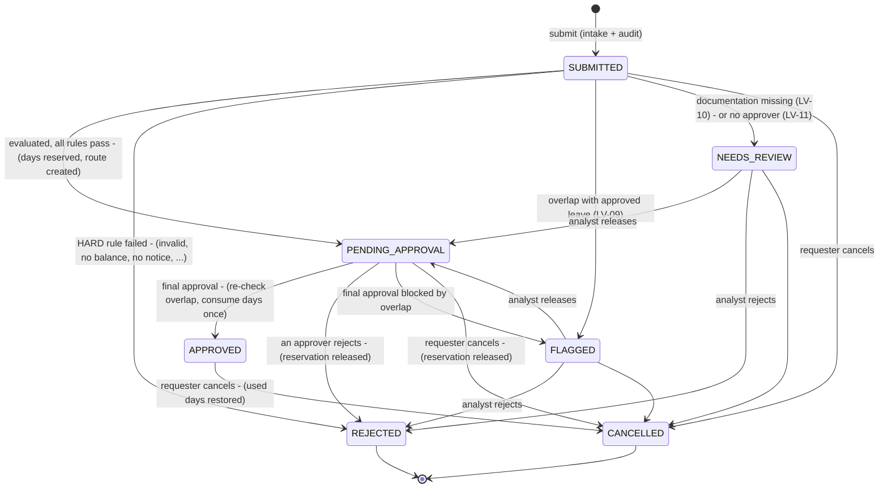
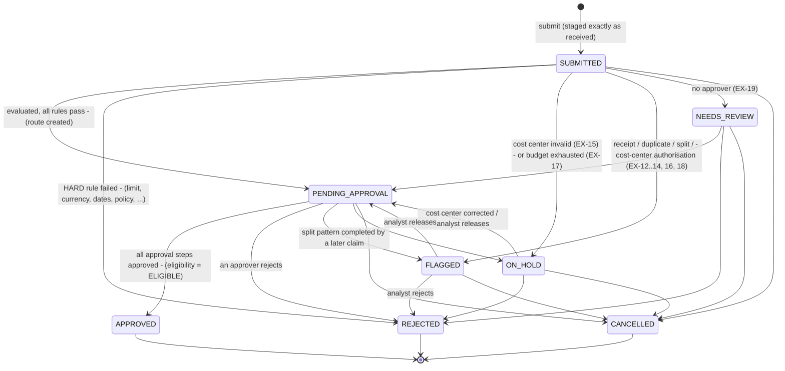
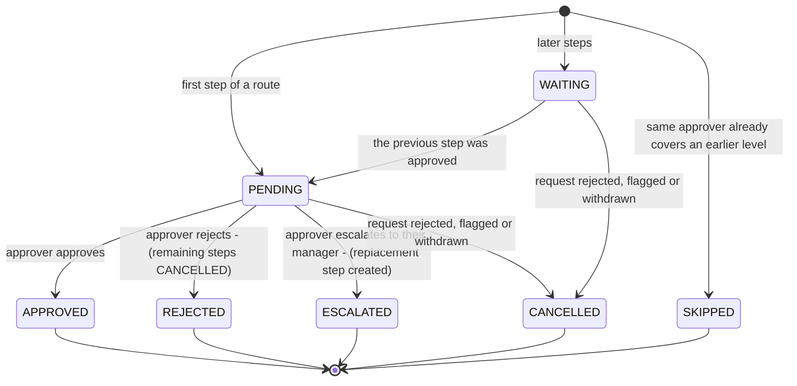
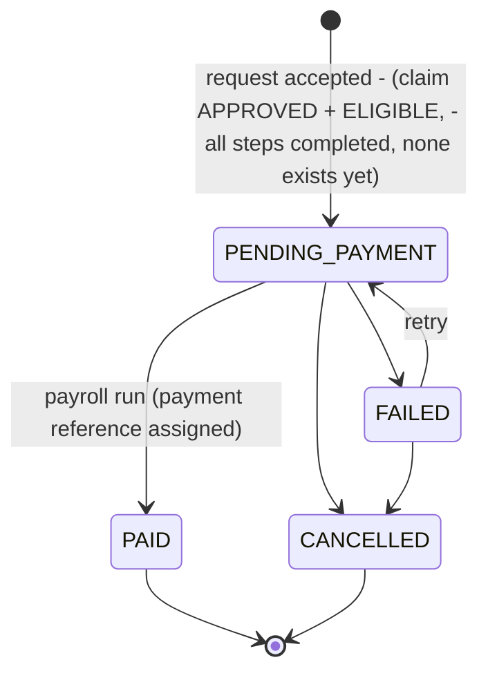
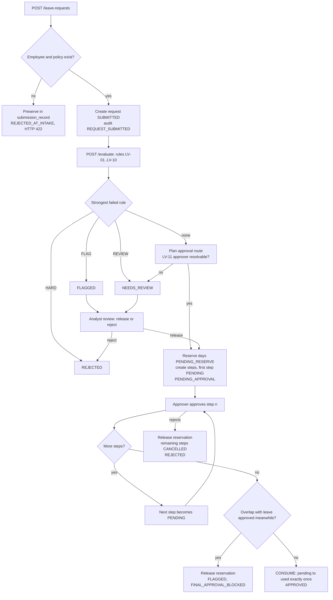
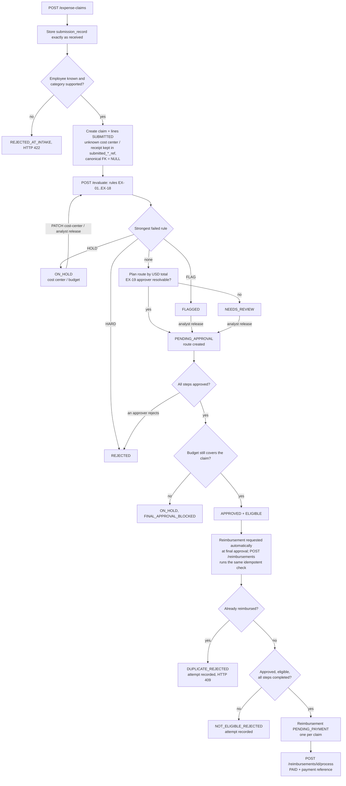
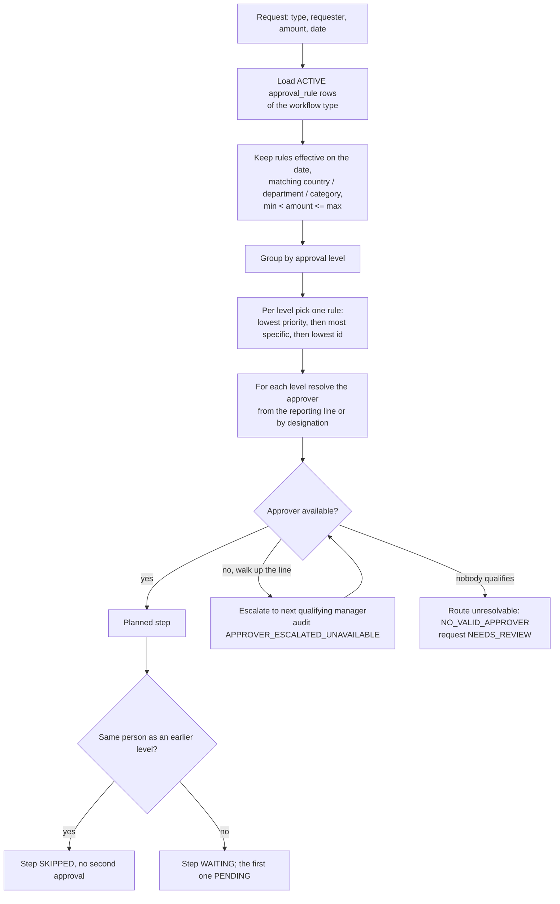
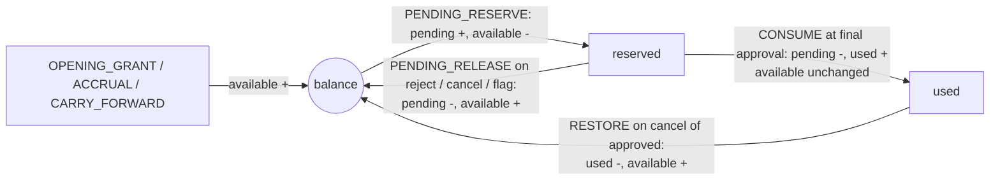
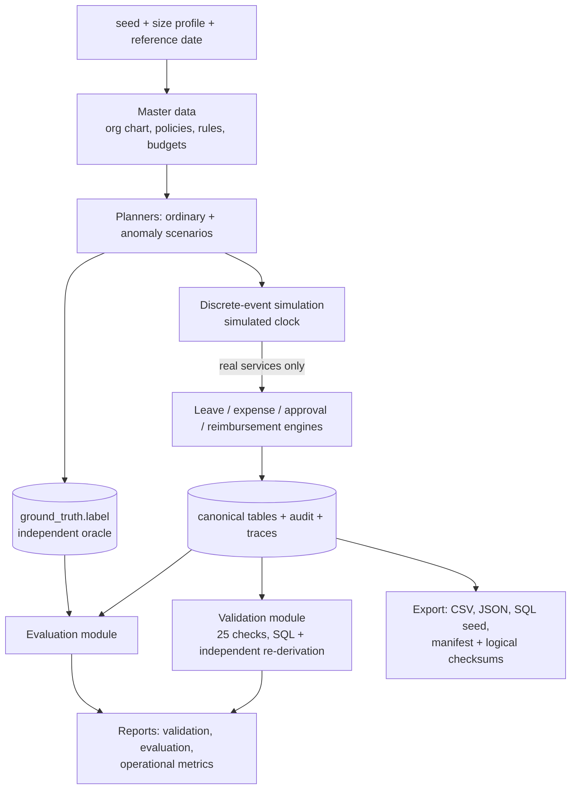

# Workflow diagrams

All diagrams are [Mermaid](https://mermaid.js.org/) and render on GitHub. The state diagrams mirror the explicit state machines in the code (`LeaveRequestStatus.LIFECYCLE`, `ExpenseClaimStatus.LIFECYCLE`, `ApprovalStatus.LIFECYCLE`, `ReimbursementStatus.LIFECYCLE`); any transition that is not drawn is rejected, audited as `INVALID_TRANSITION_REJECTED` and changes nothing.

## 1. Leave request lifecycle

## 2. Expense claim lifecycle

## 3. Approval step lifecycle

Terminal steps are immutable - enforced by the application **and** by the `trg_approval_step_guard` trigger.

## 4. Reimbursement lifecycle

Requests that do **not** create a reimbursement are not lifecycle states; they are recorded as `reimbursement_attempt` rows (`DUPLICATE_REJECTED`, `NOT_ELIGIBLE_REJECTED`).

## 5. Leave: from submission to balance consumption

## 6. Expense: from submission to reimbursement

## 7. Approval route selection

## 8. Leave balance ledger

`available = opening + accrued + carried forward - used - pending` is a generated column; the ledger rows are immutable and reconcile with the balance (validation check BI-02).

## 9. Data generation, validation and evaluation

The business engines never read `ground_truth`; only the evaluation module compares engine results with it. The simulation drives the *real* services (it does not insert rows directly), which is why the generated audit trail, balances and approval histories are genuine consequences of the business rules.
